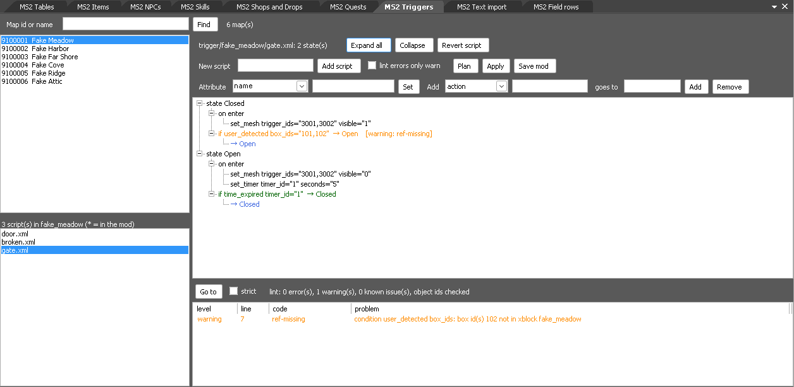

# MS2-ModTools

Tools for making custom maps and dungeons for MapleStory2 on a private server: one command takes a JSON spec and a trigger
script to a repacked set of game archives, with a new map's collision, minimap and navmesh.

This is a fan project with no game data in it. You supply your own client data, server and SDKs. The client side comes
from [MS2Recomp](https://github.com/riyukuro/MS2Recomp), the recompiled client these tools were tested with.

## Requirements

Python 3.11+ (`pip install -r requirements.txt`) and a .NET SDK always; the rest only for the part that uses it. Paths are
**settings**: environment variables, or `modtools.toml` in the repo root (copy `modtools.example.toml`). Tools that need a missing
setting stop and name it. `python3 tools/modtools_config.py` shows them all.

| you need | for | setting | where to get it |
|---|---|---|---|
| .NET 10 SDK | m2d and tokgeom (m2d also builds and runs with the .NET 8 SDK) | `MS2_DOTNET_ROOT` (optional) | <https://dotnet.microsoft.com/download> |
| Client data: `Data/` with `Xml.m2d` and `Resource/` | every map | `MS2_CLIENT_DATA` | your own client install |
| Server data: `Xml.m2d` + `Server.m2d` | every map | `MS2_SERVER_DATA` | your server's data folder, e.g. [MapleStory2-XML](https://github.com/MS2Community/MapleStory2-XML) |
| [Maple2](https://github.com/MS2Community/Maple2) server, ingest built, MySQL | navmesh, playing the map | `MS2_SERVER_DIR` | build it per its own docs |
| `ContentProcessing3D.dll` | a new map's `.tok` | `MS2_CP3D` | your own GMS2 client install |
| PathEngine SDK headers (interface 18) | compiling `tokbuild` | `MS2_PATHENGINE_SDK` | your own PathEngine license |
| clang-cl, lld-link, CMake, Ninja, [msvc-wine](https://github.com/mstorsjo/msvc-wine), Wine | compiling and running `tokbuild` on Linux | `MS2_MSVC_ROOT` | your package manager; msvc-wine downloads MSVC under Microsoft's terms |
| Gamebryo LightSpeed 3.2 SDK | Toolbench, `tools/mapedit` SDK checks | `MS2_GAMEBRYO_APPDIR` | your own SDK license |
| niftools `nif.xml` | `tools/nif` (custom boss models) | `MS2_NIFXML` (or `$NIFXML`, or `tools/nif/nif.xml`) | <https://github.com/niftools/nifxml> |
| Blender | only `tools/nif/blender_*.py` (you run it) | none | <https://www.blender.org> |

Only tested on Linux, with a KMS dev client data set and a GMS2 v1.3.2 server data set
(see ["What a custom dungeon needs"](tools/dungeon/README.md#what-a-custom-dungeon-needs)).

## Quick start

```sh
git clone https://github.com/riyukuro/MS2-ModTools
cd MS2-ModTools
pip install -r requirements.txt
cp modtools.example.toml modtools.toml      # set MS2_CLIENT_DATA and MS2_SERVER_DATA at least
python3 tools/modtools_config.py            # check

python3 tools/dungeon/build.py tools/dungeon/examples/new-arena/spec.json
```

The output is in `out/dungeon/52900010_nm/`: repacked archive copies in `packed/`, `INSTALL.txt` saying where each piece goes,
and `BUILD-MANIFEST.json`. Your originals are only read.

`new-arena` has new geometry, so it needs its own `.tok`. Without `MS2_CP3D` and tokbuild the build warns and copies the reference
map's `.tok`: the data is complete, but collision won't match the layout until you [build tokbuild](tools/tok/README.md#building-tokbuild).
Without `MS2_SERVER_DIR` the navmesh step is skipped with a note.

## The tools

| folder | what |
|---|---|
| [tools/dungeon](tools/dungeon/README.md) | `build.py`, spec to packed dungeon; new maps from a layout; clones of shipped maps; minimaps; custom bosses and skills. **Start here.** Includes the server and client steps |
| [tools/nif](tools/nif/README.md) | MS2 NIF/KF models to glTF and back; new NPC model folders for custom bosses (`numpy`; niftools `nif.xml`, `MS2_NIFXML`) |
| [tools/trigger](tools/trigger/README.md) | trigger script linter, checked against the server's trigger code and the map's objects |
| [tools/tok](tools/tok/README.md) | PathEngine ground meshes: `tokgeom` (map to geometry), `tokbuild` (geometry to `.tok`), Toolbench plugin |
| [tools/m2d](tools/m2d/README.md) | read and repack `.m2d` archives |
| [tools/modkit](tools/modkit/README.md) | mods as folders of row changes to the game's XML tables, applied to copies of the client and server archives: diff, conflict report, reserved ids, revert. Also map mods and the `map-*` commands that convert maps for the map editor, `trigger-lint` (trigger scripts, with `--strict` and the map's object ids with `--xblock` / `--exported`), `text-import` and `field-rows`. C# library (.NET 3.5 and 8) and a command line tool (.NET SDK 8+) |
| [tools/modkit/plugin](tools/modkit/README.md#the-table-editor-in-toolbench) | MS2 Tables, a Toolbench plugin: a table of the archives as a grid, edits kept as a mod, plan / apply / revert into a workspace of copies. Its other views edit items, npcs, skills, quests, shops and drops, trigger scripts, texts and field rows into the same mod: see [Toolbench views](#toolbench-views) |
| [tools/mapedit](tools/mapedit/README.md) | shipped map to Toolbench project and back; scripted map edits |
| [tools/toolbench](tools/toolbench/README.md) | run Gamebryo Toolbench / World Builder under Wine |
| [glue/pathengine](glue/pathengine/README.md) | frozen client code that tokbuild compiles |

Tests, which need no game data: `python3 -m unittest discover tests`.

## Toolbench views

The [modkit plugin](tools/modkit/README.md#the-table-editor-in-toolbench) adds a menu, **MS2 Mods**, to Toolbench. Every
view writes into the same mod. The pictures are of a made-up data set, not of game data.

| view | what it edits | side | picture |
|---|---|---|---|
| [Tables](tools/modkit/README.md#the-table-editor-in-toolbench) | any XML table of an archive, as a grid; the list of mods and their order | the archive you pick: client or server | [shot](docs/shots/tables.png) |
| [Items](tools/modkit/README.md#the-item-editor-in-toolbench) | one item: its file, name and texts, with a picture of its model; clone to a new id | both | [shot](docs/shots/items.png) |
| [NPCs](tools/modkit/README.md#the-npc-editor-in-toolbench) | one npc: its file and name, with a picture of its model; clone to a new id | both | [shot](docs/shots/npcs.png) |
| [Skills](tools/modkit/README.md#skills-and-effects) | one skill or effect with its levels and texts; clone to a new id | both | [shot](docs/shots/skills.png) |
| [Quests](tools/modkit/README.md#quests) | one quest: its file, texts and scripts; clone to a new id | both | [shot](docs/shots/quests.png) |
| [Shops and Drops](tools/modkit/README.md#shops-and-drops) | a shop's stock and a drop box's rows; new ones under reserved ids | shops: server; drops: both | [shot](docs/shots/shops-drops.png) |
| [Triggers](tools/modkit/README.md#triggers) | a map's trigger scripts as a tree, linted as shown | server (the clients carry copies) | [shot](docs/shots/triggers.png) |
| [Text import](tools/modkit/README.md#text-import) | texts of the Korean client that are still Korean, filled from another client's string files | client | [shot](docs/shots/text-import.png) |
| [Field rows](tools/modkit/README.md#field-rows) | `fielddata.xml` rows for maps the Korean client has but cannot open, built from another client's map files | client | [shot](docs/shots/field-rows.png) |



The menu also has **Plan** (what the enabled mods and the pending edits would change; writes nothing), **Apply** (saves
the mod and writes the changes: loose files into the game folder, or patched copies of the archives into the workspace
folder), **Revert** (removes what Apply wrote) and **Use the whole window** (folds Toolbench's own left and bottom panes
away when a view is opened).

## Server side

No server code changes are shipped or needed for building. To play a map (details in
["Server"](tools/dungeon/README.md#server-ingest-and-navmesh) and ["Client"](tools/dungeon/README.md#client)):

1. Ingest the packed data: point `MS2_DATA_FOLDER` in the server's `.env` at `<out>/packed/server-data/` and run the ingest.
2. Copy `<xblock>.navmesh` and its hash into the game server's **bin** `Navmeshes/` folder (`Maple2.Server.Game/bin/Release/net8.0/Navmeshes/`).
   Without it the warp fails with nothing in the log.
3. Copy the packed client archives into a client copy, and enter with the GM command `warp <map id>`.

`INSTALL.txt` in the output has these commands for your build.

## What is proven

From real runs, with the results in [What has been proven](tools/dungeon/README.md#what-has-been-proven):

- **Client load:** custom maps load in the client built from MS2Recomp, with name and minimap.
- **Triggers:** custom scripts run: banners, monster spawns, `trigger reset`.
- **Collision and navmesh:** a from-scratch map has working collision, and mobs walk on its generated navmesh.
- **Portal:** hidden and unusable before the trigger opens it, usable after.
- **Dungeon room and clear:** entry through the dungeon room, mobs killed with a player's own attacks, `DungeonClear` and the
  Results screen.
- **Custom boss:** `boss-arena`'s cloned boss with a custom skill and AI, its HP bar, telegraph and damage, killed, then the
  portal opens; also with a new model made by `tools/nif`.

**Not proven:** any stock client (see [What has been proven](tools/dungeon/README.md#what-has-been-proven)).

## License

GNU GPL version 3 ([`LICENSE`](LICENSE)) with one additional term under section 7(b), in [`NOTICE`](NOTICE): a
distributed version, or a work based on this one, must keep the attribution "Based on MS2-ModTools
(https://github.com/riyukuro/MS2-ModTools)" and, if it has a user interface, show it in an About, credits or start-up
screen. `glue/pathengine/` comes from MS2Recomp and also carries its attribution, "Based on MS2Recomp
(https://github.com/riyukuro/MS2Recomp)".

The license covers the contributors' own work here: the tools, the examples, the build files and the documentation.
Third-party code keeps its own license (listed in [`NOTICE`](NOTICE)).

## Legal

This project is not affiliated with Nexon. MapleStory2 is a trademark of Nexon. The repository contains no game assets,
executables or engine source, and no PathEngine, Gamebryo, CP3D or Toolbench binaries or headers; you supply your own. See
[NOTICE](NOTICE).
