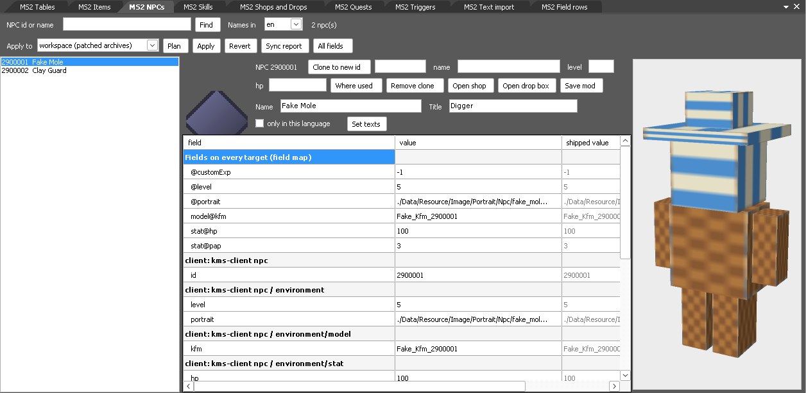
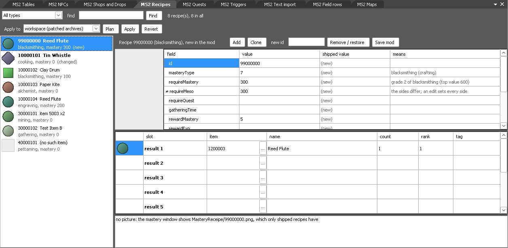
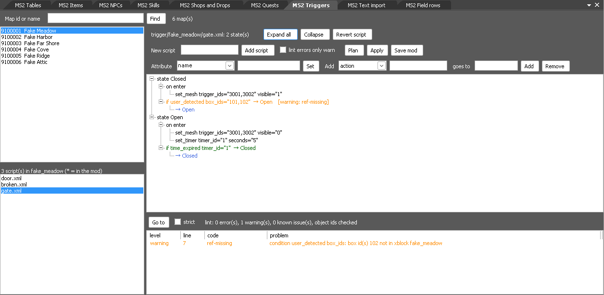
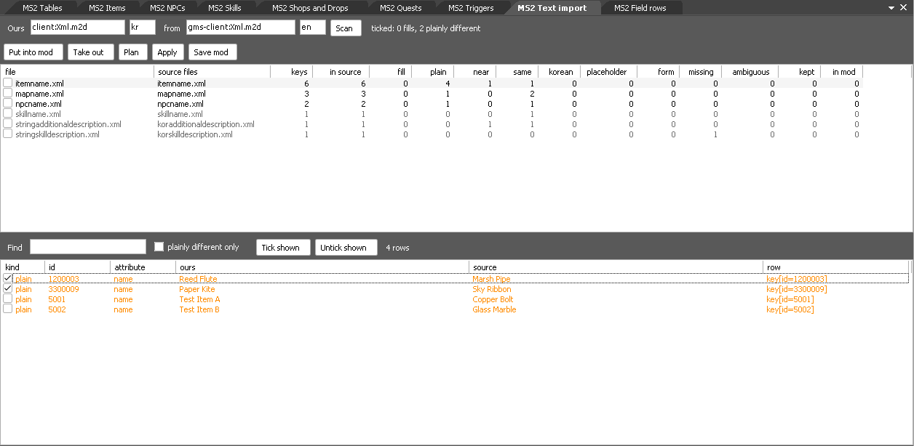
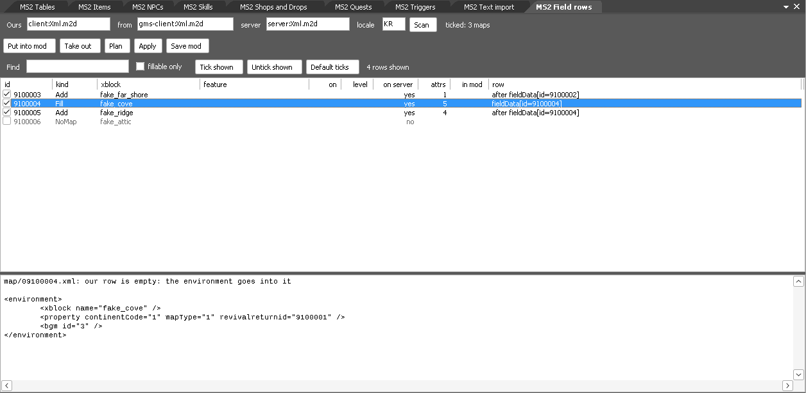
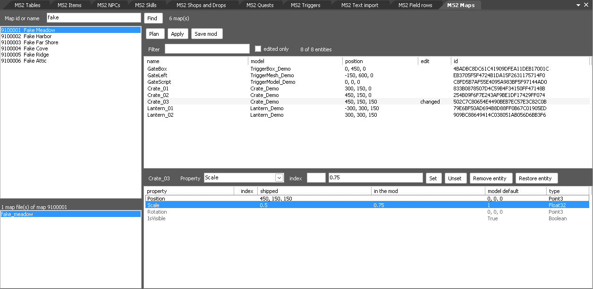
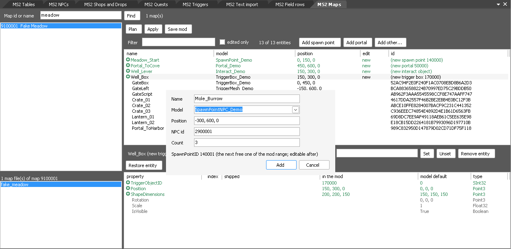

# modkit: row-level mods for game tables

A mod is a folder with a `mod.xml` that lists rows to change, add and delete in the game's XML tables. modkit applies
any number of mods to **copies** of the archives (`Xml.m2d` of the client, `Xml.m2d` and `Server.m2d` of the server)
and leaves the originals alone. Entries and rows that no mod touches keep their bytes.

- `MS2.ModKit/` is the library (C#, built for .NET 3.5 and .NET 8). Everything is in it: the `.m2d`/`.m2h` reader and
  writer, the XML editing, the manifest, the checks, apply and revert. It prints nothing and never exits the process,
  so an editor (a Toolbench plugin) can load it in-process.
- `cli/` is a small command line tool over the library (.NET 8).
- `plugin/` is the table editor: a Gamebryo Toolbench plugin over the library (see
  [The table editor in Toolbench](#the-table-editor-in-toolbench)).
- `tests/` are the tests; `examples/pets/` is a made-up data set with three mods to try things on.

No game data is in this repo, and none is needed for the examples or the tests.

## Build

Needs the .NET SDK 8 or later (with a later SDK only, set `DOTNET_ROLL_FORWARD=Major` to run the net8.0 outputs).

```sh
cd tools/modkit
dotnet build cli -c Release -o cli/bin          # cli/bin/modkit.dll, run with: dotnet cli/bin/modkit.dll
dotnet build MS2.ModKit -c Release              # MS2.ModKit/bin/Release/net35/MS2.ModKit.dll for a plugin
```

Below, `modkit` stands for `dotnet tools/modkit/cli/bin/modkit.dll`.

The data folders come from `MS2_CLIENT_DATA`, `MS2_GMS_CLIENT_DATA` and `MS2_SERVER_DATA` (environment, then
`modtools.toml`, as for the other tools) or from `--client DIR`, `--gms DIR` and `--server DIR`. Set the ones you have.
Archives are named `<root>:<path>`: `client:Xml.m2d` (the Korean client), `gms-client:Xml.m2d` (the global client),
`server:Xml.m2d`, `server:Server.m2d`. Which client is which: [Profiles](#profiles-which-data-you-have).

## Try it on the example

The example data is plain files; `pack` makes two small archives from them.

```sh
D=/tmp/modkit-demo; E=tools/modkit/examples/pets
modkit pack $E/data/client/Xml $D/client/Xml.m2d NS2F
modkit pack $E/data/server/Xml $D/server/Xml.m2d
O="--client $D/client --server $D/server --schema $D/schema"

modkit rows client:Xml.m2d table/pet.xml $O            # how to name each row
modkit diff $E/mods/bigger-pets $E/mods/new-pet $O     # what would change, nothing is written
modkit apply -w $D/ws $E/mods/bigger-pets $E/mods/new-pet $O
modkit status -w $D/ws
modkit revert -w $D/ws example.new-pet $O              # the copies without that mod
modkit revert -w $D/ws $O                              # no mod left: the copies are removed
```

`diff` prints one line per change:

```
client:Xml.m2d table/pet.xml pet[id=100] @hp: "50" -> "65"
client:Xml.m2d table/pet.xml pet[id=100] @speed: "1.5" -> (removed)
client:Xml.m2d table/pet.xml pet[id=101]/skill[id=8] @level: "2" -> "3"
client:Xml.m2d table/pet.xml pet[id=900] + <pet id="900" name="Cinder" hp="70" speed="2"> ... </pet>
client:Xml.m2d pet/900.xml + entry (copy of pet/101.xml, 124 bytes)
2 mod(s): 13 change(s) in 4 entries of 2 archive(s); 0 error(s), 0 conflict(s), 0 warning(s)
```

and `validate` with the third example mod, which is made to collide with the other two:

```
warning: [example.rival-pets] id 905 of space "pet" is added in 1 of 2 places; nothing is added in server:Xml.m2d pet/{id}.xml
warning: [example.rival-pets] client:Xml.m2d table/pet.xml: attribute glow is never set on ms2/pet in the shipped table/pet.xml
conflict, example.rival-pets wins: [example.bigger-pets] client:Xml.m2d table/pet.xml: pet[id=100] @hp: "65" here, "80" in mod example.rival-pets
conflict, example.rival-pets wins: [example.bigger-pets] client:Xml.m2d table/pet.xml: changes the row pet[id=101]/skill[id=8] that mod example.rival-pets deletes
conflict, no winner: [example.rival-pets] ids space "pet": the range 905-915 overlaps 900-909 of mod example.new-pet
error: [example.rival-pets] client:Xml.m2d table/pet.xml: new id 905 of space "pet" is already used in the original data (server:Xml.m2d pet/{id}.xml)
priority, the highest first: example.rival-pets > example.new-pet > example.bigger-pets
example.rival-pets wins 2 parts of example.bigger-pets
```

## The manifest: mod.xml

```xml
<mod id="example.new-pet" name="A new pet" version="1.0">
  <description>free text</description>

  <ids space="pet" from="900" to="909">
    <where archive="client:Xml.m2d" entry="table/pet.xml" rows="pet"/>
    <where archive="server:Xml.m2d" entry="table/pet.xml" rows="pet"/>
    <where archive="client:Xml.m2d" entry="pet/{id}.xml"/>
    <where archive="server:Xml.m2d" entry="pet/{id}.xml"/>
  </ids>

  <edit archive="client:Xml.m2d" entry="table/pet.xml">
    <change at="pet[id=100]">
      <set name="hp" value="65"/>
      <unset name="speed"/>
    </change>
    <add copy="pet[id=101]">
      <set name="id" value="900"/>
      <set at="skill[id=7]" name="level" value="4"/>
    </add>
    <delete at="pet[id=102][feature=Alpha]"/>
  </edit>

  <entry archive="client:Xml.m2d" name="pet/900.xml" copy="pet/101.xml"/>
  <entry archive="server:Xml.m2d" name="pet/900.xml" file="data/pet-900.xml"/>
</mod>
```

**Every op names its archive.** The client and the server each have their own copy of most tables, and a mod says
which it changes. A table that both sides hold in the same format is written twice, once per side. For items,
whose two sides are different files, modkit writes the other side itself; see
[One mod, both sides](#one-mod-both-sides). `sync="false"` on an `<edit>`, a `<change>` or a `<set>` keeps it on its own side.

| element | meaning |
|---|---|
| `<mod id name version>` | `id` is required (letters, digits, `.`, `-`, `_`) and is what `revert` and the reports use |
| `<edit archive entry>` | row ops on one entry (one XML file inside the archive) |
| `<change at>` | change the row at the selector; holds `<set name value>`, `<unset name>`, `<text value>` (the element's text). Each of them takes `at="..."` to reach an element under the row |
| `<add copy>` | a new row that is a copy of the row at the selector, changed by the `<set>`/`<unset>`/`<text>` inside |
| `<add><xml>…</xml></add>` | a new row written out (one element) |
| `<add after= before= in=>` | where the new row goes: after or before a row, or as the last child of one. Default: last in the parent of the copied row, or last in the root element |
| `<delete at>` | remove the row with everything in it |
| `<entry archive name copy>` | a new entry as a copy of another entry of the same archive; it can be edited by an `<edit>` further down |
| `<entry archive name file>` | a new entry, or a whole-entry replacement, from a file of the mod folder |
| `<entry archive name delete="true">` | remove an entry |
| `<ids space from to>` | the id range this mod reserves, and with `<where>` every place such an id lives (see below) |

Unknown elements and attributes in `mod.xml` are errors with a line number, so a typo does not pass silently.

### Row selectors

A selector is a path of steps from the entry's root element, joined by `/`:

```
pet[id=101]                       the <pet> whose id is 101
pet[id=101]/skill[id=8]           a row inside it
pet[id=102][feature=]             of the rows with id 102, the one with no (or an empty) feature
pet[id=102][feature=Alpha]        ... and the one for feature Alpha
drop[#3]                          the third <drop>, for rows that have nothing to tell them apart
*[id=5]                           any element name
key[name='a b']                   quotes for values with spaces, brackets or slashes
```

A selector must match exactly one element; none or several is an error that lists what it found. `modkit rows
<archive> <entry>` prints a selector for every row of an entry, and `modkit rows <archive> <entry> <selector>` for
the rows inside one.

### Reserved ids

`<ids>` says "this mod owns ids 900 to 909 of the space `pet`" and lists where a pet id lives: in rows of a table
(`rows="pet"`, id attribute `key="id"` by default) or in the name of an entry (`entry="pet/{id}.xml"`). Then:

- an id that the mod adds must be free in **all** the places, on both sides, in the original data: taken anywhere is
  an error (`strict="false"` on `<ids>` makes it a warning);
- an added id outside the reserved range is a warning;
- two mods whose ranges of one space overlap are a conflict;
- an id added in some of the places and not in others is a warning (often right, sometimes a forgotten side).
  Places with the same `any="group"` on their `<where>` are alternatives: an id in one of them is enough (an
  option code is a constant code, a static code or both);
- a row the mod deletes and adds again (a whole row written anew) keeps its id: it is not a new one.

`modkit next-id <mod> <space> [count]` prints free ids of the range.

## Applying

```
modkit validate <mod>...                 errors, conflicts, warnings
modkit diff <mod>...                     the same, and every change
modkit apply -w <workspace> <mod>...     write the modded copies
modkit revert -w <workspace> [mod id]    without that mod / without any
modkit status -w <workspace>
modkit apply --game <game folder> <mod>...   the client's changed tables as plain files under <game folder>/Data/Xml
modkit revert --game <game folder>           remove the files that apply --game wrote
modkit status --game <game folder>
```

- The workspace is a folder of your choice. `apply` writes `<workspace>/client/Xml.m2d` (+ `.m2h`),
  `<workspace>/server/Xml.m2d` and so on, only for archives that a mod touches (`--also-copy ARCHIVE` adds an
  untouched one), and `modkit-state.xml`, which lists the mods that are in. It refuses a workspace that is inside a
  data folder or holds one: originals are opened for reading only.
- Every `apply` starts from the originals, so applying a list of mods always gives the same result, whatever was in
  the workspace before. `revert` is the same thing with one mod less; with none left it removes the copies.
- Two mods that set the same attribute of the same row to different values, a mod that deletes a row another one
  changes, two that add the same id or entry: these are **conflicts**. With a conflict or an error nothing is
  written (exit code 1). `--allow-conflicts` applies anyway, and the mod of the higher priority wins.
- **Priority.** Of the mods given, a later one is higher than an earlier one. `--priority ID,ID,...` names mod ids
  with the highest first: the named mods are above all others, the others keep their order below them. An id
  that none of the given mods has is a usage error. Without the option the list is read from the setting
  `MS2_MOD_PRIORITY` (environment, then `modtools.toml`), which may also name mods that are not given this time.
  Every conflict line begins with the outcome (`conflict, X wins:` or `conflict, no winner:`), a line
  `priority, the highest first: c > a > b` follows the conflicts, then one line per pair of mods where
  something is left out (`c wins 2 parts of b`: two things mod b asks for are not in the result, because mod c
  has them; the conflict lines of mod b say which). `--json` has `priority`, and a `winner` and a `loser` per
  conflict. The mod a line names as the winner is the one whose part is written: its value, its delete, its new
  row or its entry; the lower mod's part of that conflict is left out, and the rest of the lower mod still
  applies. The mods are planned from the highest down (edit lines, groups, skill lines and maps alike), so what a
  mod gets never depends on a third mod that loses, and new rows that two mods add at one place are written
  with the lower mod's rows first: where the highest of three changes a row that the middle one deletes, the row stays and the lowest
  one's change of another field of it is written too. A whole entry (`<entry file=...>`) against an edit of
  that entry goes the same way: the higher mod's entry is written as that mod has it, and the higher mod's edit
  is made in the shipped entry, without the lower mod's file (in the lower mod's entry only where that mod adds
  an entry the game does not ship). A line that is mirrored to another target is decided against the lines
  for that target like any other line, and such a conflict stops `apply` like any other.
  A few conflicts have no winner and name none: two mods whose id ranges overlap, a new id that two mods add
  in different places, a mod that contradicts itself (it changes a row and deletes it, sets one value twice, or adds one row twice;
  this is found also where a higher mod has both of its lines left out),
  and a file in the game folder that this tool did not write. No priority decides these, so they stop `apply`
  with `--allow-conflicts` as well, until the mods are changed.
  A mod's own contradictions and errors are the same in every plan, whatever the other mods do. Looking for
  them costs plan time only for a mod that has a conflict with another mod in an entry where it has two or more
  lines, or whose shop, drop box or skill lines meet another mod (measured with one large mod under a delete:
  up to about twice the plan time, and none where the mods do not meet).
- After writing, the changed entries are read back from the copy and compared. `--verify-all` also compares every
  untouched entry with the original.
- Point the game at the copies yourself (or copy them over a **copy** of the game folder). For the server see
  [How the game gets the changes](#how-the-game-gets-the-changes).
- `--game` takes the folder of a **copy** of the client (the folder that holds `Data`) and writes the client's part
  as loose files there, which the client reads without anything else being done; see
  [How the game gets the changes](#how-the-game-gets-the-changes). The archives of the game folder are not changed.
  With `--game` alone the server's part of the mods is planned and reported as left out; give `-w` as well and the
  server archive is written to the workspace in the same run.

What "kept" means: an entry that no mod touches is copied as stored (compressed and encrypted bytes, flags, order).
In an edited entry only the edited spans change: encoding, byte order mark, line ends, attribute order, quotes,
comments and indentation of everything else stay. New rows take the indentation and line ends of their neighbours.

## Schemas

modkit does not ship a description of the tables. `modkit schema build` derives one from **your** archives: for each
table, the elements, their attributes, how often each occurs, the kinds of value seen (empty, int, float, list, text)
and the numeric range. Entries that differ only by a number in the name are one table (`npc/21000001.xml` is
`npc/#.xml`). `modkit schema show <archive> [table]` prints it.

The cache (default `out/modkit/schema/`, or `--schema DIR`) holds sample values from the game data: it stays on your
machine and is never committed. Rebuild it when the archives change; modkit notices a stale one.

With a schema, `validate`/`diff`/`apply` warn about a new value that the shipped data never shows: an attribute that
is never set on that element, or a kind of value never seen for it (text where every shipped value is an int). These
are warnings, never refusals: the shipped data is the best evidence there is, but it does not show everything the game
accepts.

`schema-notes.xml` holds what the data cannot show. It names attributes only, never values:

```xml
<notes>
  <attr archive="client:Xml.m2d" table="table/pet.xml" element="ms2/pet" name="glow"
        source="client" ref="ms2/commonfiles/petloader.cpp:120"
        use="whole number kept with the pet; the pet window reads it"/>
</notes>
```

`source="client"` means the client's loader reads the attribute (`ref` cites the file and line of the read,
`use` says in our own words what the loader does with the value; neither copies code or data);
then the "never set" warning becomes a note that shows both. `source="maple2"` means only the Maple2 server code says so: it is shown
as unverified and the warning stays. The order of trust is shipped data, then the client loader, then Maple2.

`modkit schema cite <archive> <table> <element> <attr> --src DIR` helps to write such a line. It lists the lines of
a source tree that hold the attribute name as a string, the files that also name the table first (`table`), the
rest after them (`other`), and prints a draft `<attr>` line for the first `table` hit. It only searches text: read the
cited line before you add the draft, because the same attribute name is read for many tables.

## Using the library

```csharp
using MS2.ModKit;

using (var data = new DataSet(clientDataDir, serverDataDir))
{
    var mods = new List<Mod> { Mod.Load(modFolder) };
    var schemas = SchemaSet.Load(schemaDir, data);                  // optional
    Plan plan = Planner.Build(data, mods, new PlanOptions { Schemas = schemas, Progress = p => ... });
    // plan.Changes, plan.Errors, plan.Conflicts, plan.Warnings, plan.Notes: show them

    var ws = new Workspace(workspaceDir);
    ApplyResult r = ws.Apply(data, mods, new ApplyOptions { Schemas = schemas, VerifyAll = true });
    if (!r.Applied) { /* r.Reason, r.Plan */ }
    ws.Revert(data, "some.mod.id", new ApplyOptions());
}
```

- Failures are `ModKitException` with a message meant for the user. No console output, no `Environment.Exit`.
- `M2dArchive` (read), `M2dWriter.Rewrite` / `M2dWriter.Create` (write), `Xml.XmlDoc` and `Xml.RowPath` are public
  for tools that need less than a whole mod.
- The net35 build has no dependency beyond the .NET Framework 3.5 class library. It was run as a 32-bit process on
  CLR 4 under Wine (the way Toolbench runs there): plan, apply, read back and revert of the example, and a cp949
  entry with a Korean name, with `Z:\...` paths.
- Archives written on .NET 8 are byte for byte what `tools/m2d` writes. On another runtime the compressed bytes of the
  entries that were changed can differ (its zlib is another one); the contents are the same and every reader reads
  them. Untouched entries are copied as stored on every runtime.

## The table editor in Toolbench

`plugin/` is a plugin for Gamebryo LightSpeed 3.2 Toolbench (your own copy, from your Gamebryo SDK; see
[tools/toolbench](../toolbench/README.md) for running it under Wine). It adds a view, **MS2 Tables**, that shows one
XML entry of an archive as a grid, keeps your edits as a `mod.xml`, and runs plan, apply and revert. It holds no logic
of its own: `MS2.ModKit.dll` does the work, as it does for the command line tool.

Every editor opens as a tab of the centre area. The tab row has no second line, so the tabs shorten their labels
to stay on it: `MS2 Item options` becomes `Item options`, then `Options`, as the window gets narrower (the full
name stays in the tab's tooltip). All editors fit on the row from 1280 pixels of width.

Build and install (the Toolbench assemblies are referenced in place, nothing of the SDK is copied):

```sh
dotnet build tools/modkit/plugin -c Release -p:ToolbenchDir=<Gamebryo SDK>/sdk/Win32/Bin/VC90/Shipping
```

Copy `MS2.Tables.dll`, `MS2.ModKit.dll`, `plugin.xml` and `schema-notes.xml` from `tools/modkit/plugin/bin/Release/` into
`<Toolbench>/Plugins/MS2.Tables/`.

Settings (menu **Utilities > Settings...**, page "MS2 Mods"; per user, all empty by default). While a setting is empty its
environment variable is used, so a script can start Toolbench with the folders already set:

| Setting | Environment | Meaning |
|-|-|-|
| Korean client data folder | `MS2_CLIENT_DATA` | the `Data` folder of a Korean client (`kms-client`, holds `Xml.m2d`). Only read. Empty when you have none |
| Global client data folder | `MS2_GMS_CLIENT_DATA` | the `Data` folder of a global client (`gms-client`). Only read. Empty when you have none |
| Server data folder | `MS2_SERVER_DATA` | the data folder of your local server (holds its `Xml.m2d`). Only read |
| Mods folder | `MS2_MODS` | a folder of mod folders. Save mod writes `<mods>/<mod id>/mod.xml`; the view lists its mods (a folder whose name starts with `.` or `_` is left out) |
| Workspace folder | `MS2_MOD_WORKSPACE` | where Apply writes patched copies of archives: the server's always, the client's when you apply to the workspace |
| Game folder | `MS2_GAME_DIR` | the folder of a **copy** of your client that holds `Data`. Apply writes the client's changed tables there as plain files |
| Schema cache folder | `MS2_MOD_SCHEMA` | optional: the folder `modkit schema build` wrote (`out/modkit/schema` by default). When set, Plan and Apply check the mods against it; both empty = no check |

One data folder is enough to look around; saving needs the mods folder, and apply the game folder or the workspace
folder as well. After changing a setting press **Reload settings** in the view.

Using it:

1. The view opens docked at the right edge, at 60 % of the window (menu **MS2 Mods > Tables** shows the view
   again). Pick an archive, type part of an
   entry name into **Entry filter** and press Enter, or double-click an entry in the list. Each child element of the
   root element is a row and each attribute a column. For rows that sit deeper, put a selector of their parent into
   **Rows under** (for example `pet[id=101]` to see that pet's `<skill>` rows).
   The first time one of the MS2 views is opened in a Toolbench session, Toolbench's own Game Solution pane (left)
   and Output View pane (bottom) are folded away to their edge tabs, so the view has the window. A pane you pin
   open again stays open; **MS2 Mods > Use the whole window** turns this off, and the choice is kept.
2. Edit cells. An edited cell turns yellow, and the **Pending changes** pane shows the `mod.xml` the edits make.
   Typing the original value back takes the change out again. **Clone row** adds a row that starts as a copy of the
   selected one (green; change its id), **Delete / restore row** deletes a row or takes the delete back, **Remove
   attribute** takes the attribute of the selected cell off its row, **Add column** adds a column for an attribute no
   row has yet.
3. A table that is in the client and in the server archive has to be changed in both. **Copy edits to other side**
   writes the edits of the open table into the mod for the other data root too.
4. **Save mod** writes the mod folder. **New mod** starts an empty mod with the id in **Mod id** (the first mod is
   called `my.mod`).
5. The **Mods** list shows the mods of the mods folder. A checked mod is applied, an unchecked one stays in the
   folder and is left out. The list is the priority: the numbers start at the top with 1, the highest, and where
   two mods set the same thing the higher one wins. **Up** and **Down** move the selected mod, or drag it to its
   place with the mouse. A mod folder that is new goes to the end of the list; the mod being edited, when it is
   not saved yet, is above all. **Higher mod wins a conflict** under the list decides what a conflict does: off,
   Apply writes nothing while mods conflict; on, Apply goes on and the higher mod's change is written (a conflict with no winner stops Apply
   either way). Either way
   Plan shows the order first, then how many parts of a mod are left out and for which mod (`c wins 2 parts of b`), then the
   conflicts, every conflict line beginning with its winner (`conflict, X wins:`). A click on a mod's box
   checks or unchecks it; a click on its name selects it. The box is kept in the Toolbench settings and
   holds for the other MS2 views too. **Load mod** (or a double-click) loads the selected mod into the
   grid. The mod being edited is marked and always takes part, checked or not. The checks and the order are kept in
   `modkit-mods.xml` in the mods folder; the mod folders themselves are not changed by them. (A list saved by an
   earlier version had the winner at the bottom; it is turned round when it is read, so the same mod still wins.) When the view opens and
   the mods folder already has a mod with the id being edited (`my.mod` at first), that saved mod is loaded, so work
   goes on where it was saved. When Toolbench is closed with changes that were not saved, it asks first: Yes saves
   the mod, No drops the changes, Cancel keeps Toolbench open. Closing only the view's pane hides it and keeps the
   changes.
6. **Apply to** chooses where the client's tables go: **game folder (loose files)**, the default once a game folder is
   set, or **workspace (patched archives)**.
7. **Plan** shows what the checked mods plus the pending edits would change, with errors, conflicts and
   warnings, and writes nothing. **Apply** saves the mod being edited and writes; with an error or a conflict it
   writes nothing and says why. **Revert** removes what Apply wrote. The three are also in the **MS2 Mods** menu.
   They run in the background: the view is greyed out and shows the progress beside the buttons until the result
   is in the **Output** pane.
   The first Plan reads the archives; a later Plan on the same data reuses what was read and is several times
   faster. Anything kept is dropped when the data or the mod changes.

### How the game gets the changes

**Client: loose files.** The client looks for a data file as a plain file under its `Data` folder before it looks
into the archives: `Data/Xml/table/pet.xml` is used in place of the entry `table/pet.xml` of `Data/Xml.m2d` (a file in
a region sub-folder of `Data/Xml`, if there is one, comes before both). So with **Apply to: game folder**, Apply writes
each client entry that a mod changes, whole and merged, to `<game folder>/Data/Xml/<entry>`, and the archives of the
game folder stay as they are. Start the copy of the client; nothing else is to be done.

- `modkit-loose.xml` in the game folder records every file Apply wrote, with its hash. **Revert** deletes exactly
  those files (and the folders Apply made, when they are empty) and nothing else. A recorded file that was changed
  since is left where it is and reported.
- A file that is already there and is not in the record is never overwritten. Plan lists it as a conflict and Apply
  writes nothing, also when conflicts between mods are allowed; move the file away yourself if the mod should win.
- A mod that deletes a client entry cannot be applied this way (a loose file can replace an entry, not hide it);
  Plan says so. Use the workspace target for such a mod.
- Use a copy of the client, as with every change to a game folder.

**Client: patched archives.** With **Apply to: workspace**, Apply writes `<workspace>/client/Xml.m2d` and `Xml.m2h`
(only the archives a mod touches). Copy them over the files of the same name in the `Data` folder of a copy of the
client after each apply; after Revert put the original files back the same way.

**Local server.** The server has no loose files. When a mod touches a server archive, Apply always writes the
changed archive to the workspace (`<workspace>/server/Xml.m2d`), whichever target the client's tables go to. What
is left to do depends on the server:

- A server that reads the archives directly takes the changed archive by copy: put it in place of the file of the
  same name in a copy of the server's data folder.
- A server that builds a database from the archives needs its ingest step run again on the changed archive before
  a change shows. modkit does not touch a database.

The original data folders in the settings are never written. Switching **Apply to** and applying again removes what
the other target left behind.

With the **Schema cache folder** set, Plan and Apply print the lines the command line prints with `--schema` (the view
goes through the same check): `warning: ... attribute glow is never set on ms2/pet in the shipped table/pet.xml` for
an attribute or element the shipped table never has, and a `note:` with the place and the use where
`schema-notes.xml` says the client reads the attribute. The notes file is the `schema-notes.xml` next to the plugin,
or the one of the checkout the plugin runs from. The view does not build the cache; `modkit schema build` does, and a
folder without one gives the note "no schema is cached for this archive". A warning never stops an apply.

Not in this editor yet: `<ids>` ranges, `<entry>` operations and edits
of element text. A mod that holds them loads, plans and applies as it is; the grid just has no cell for them.

## The item editor in Toolbench

The same plugin has a second view, **MS2 Items** (menu **MS2 Mods > Items**). It is for one thing: looking up an
item, changing it, and making a new item from a shipped one. It writes into the mod that the MS2 Tables view is
editing, so everything above holds: the same `mod.xml`, the same Save, mod list, Plan, Apply, Revert and the same
question when Toolbench is closed. An edit made in one view shows in the other.

### What one item is made of

An item is not one row. The view collects the pieces and shows them as sections of one grid:

| Section | Where it is | What it holds |
|-|-|-|
| client item | client `Xml.m2d`, `itemdata/NNN.xml`, one `<item id>` row | everything the client knows about the item: slot, icon, model, limits, the stat row it names. `NNN` is the id divided by 100000, and the client looks for an id only in the file of its block |
| name | client, `string/<language>/itemname.xml` | the name, once per language folder |
| plural | client, `string/<language>/itemnameplural.xml` | the plural name, where the language has one |
| description | client, `string/<language>/koritemdescription.xml` | the tooltip text and a second line |
| stat row | client, `table/itemoptionconstant.xml` | the fixed stats the item names by a code. **Shared**: many items name the same row; edit it in [Item options](#item-options) |
| server item | server `Xml.m2d`, `item/<d>/<dd>/<id>.xml` | the server's own file for the item, in its own format |

A section that the data does not have for an item is simply not there. Without a server data folder the server
section is missing and the mod holds the client half only.

### Using it

1. Type an id, or part of a name, into **Item id or name** and press Enter. **Names in** picks the language folder
   whose names are searched and listed. The list shows shipped names; items the mod adds come first, marked `(new)`.
   Each line starts with the item's icon, read from the client data folder and kept for the session; an empty box
   means no data folder has that image. The picked item's icon is shown larger above the grid.
2. Pick an item. The grid shows every field with its value and the shipped value. Edit the value: the cell turns
   yellow, and typing the shipped value back takes the edit out of the mod.
3. **Client and server together** (on by default): an edit of a field that both sides hold is written to both, in
   each side's own format. Fields that exist on one side only are changed on that side only. With the box off, the
   edit stays on the side you typed it in and Plan warns about it. **Sync report**, **All fields** and **Server
   rows** are described under [One mod, both sides](#one-mod-both-sides).
4. **Name**, **Description**, **Second line** and **Set texts** write the texts into every language folder at
   once, so the item reads the same whichever one your client uses.
5. The stat row is shared. Changing it changes every item that names its code. **Own stat row** copies the row to
   the code you type (one that is not used yet) and points this item at the copy, so the edit stays with this item.
6. **Save mod** is the Tables view's Save. **Apply to**, **Plan**, **Apply** and **Revert** at the top of the view
   are the ones of the Tables view (the same target, mods and background run), with the result in the Items view's
   own output box; the Tables view does not have to be open. The **MS2 Mods** menu commands write to the output
   box of the view you used last.

### The model picture

To the right of the form is a still picture of the picked item's model, drawn by the plugin itself from the model
(`.nif`) and texture (`.dds`) files of the Korean client's data folder; no Gamebryo renderer or graphics device is
used. The files are the ones the item's slots name: the client's `itemmodel/` row of the item, else the slots of
the server's item file. An item is shown alone, not on a
character; a part that hangs on a character's node (a hat on the head) is put where that node is in the character's
skeleton. When the item has a model for each gender, a **Male** / **Female** button switches between them.

The box says `no model` when the item names none, and `cannot show: <reason>` when a file is missing or does not
read; a missing texture only leaves that part plain. The picture is the bind pose, with no animation. The box is
left out when the view is too narrow for it.

### An own icon: Icon...

**Icon...** gives the picked item an icon of your own from a PNG file. The image goes into the mod as a new entry
`item/icon/mod/<id>.png` of `Resource/Image.m2d`, once for each client data folder that has that archive (the
Korean and the global client read their own). The item's `property@slotIcon` names it on both sides:
`./Data/Resource/Image/item/icon/mod/<id>.png`. The server draws no icons and gets no image. The list, the large
icon and the grid show the new icon at once, before the mod is saved.

The shipped item icons are 60x60 RGBA PNG files. Another size is taken, but the client draws it scaled, and the
view and Plan say so. **Take out icon** drops the image entries and puts each side's shipped `slotIcon` back (for a
clone: its source's).

Plan checks the images too:

- an image a mod puts into an image archive that is not a PNG file is an error (the client shows nothing);
- an item icon that is not 60x60 is a warning, and so is an image that replaces a shipped one (everything that
  names it shows the new one);
- a `slotIcon` a mod sets that names an image neither the client's image archive nor a mod has is a warning (the
  item shows an empty slot).

### A new item: Clone to new id

Select a shipped item and press **Clone to new id**. With the id box empty the next free id after the source is
taken; or type one.

- The new id must be in the same block of 100000 as the source (`1200001` can be cloned to `1200004`, not to
  `1300000`). The client finds an item by the file of its block, and the block also says what kind of item it is.
- The id must not be used by the data or by the mod. It is written into the mod's `<ids>` so that two mods that
  take the same id are reported as a conflict.
- The clone gets its own copy of every piece: the client row, a name, plural and description row in every
  language, and the server's file under the new id. It keeps the source's icon, model and stat row until you change
  them.
- A clone cannot be cloned again; clone the shipped item once more. **Remove clone** takes a clone out of the mod.

### What is client-side and what the server decides

- **Client only, visible at once**: names, tooltip texts, icon, model and whatever else the client draws from its
  own tables. Apply to the game folder, start the client, and they show for every such item you meet, on any
  server. The server never sees these files.
- **Decided by the server**: whether an item id exists at all, who gets it, what it sells for, its level and job
  limits when you try to equip it, and the stats an item is rolled with. The server works from its own tables. A
  changed number in the client's tables alone changes at most what a tooltip says, not what happens.
- **How the server gets its half**: Apply writes the changed server archive to the workspace, and the server
  takes it by copy or by its ingest step, as said under
  [How the game gets the changes](#how-the-game-gets-the-changes). Until then the server does not know a changed
  or new item.
- **A new item shows nowhere by itself.** After Apply the client knows the clone, and nothing more happens until
  the server knows the id too and gives the item to a character (a shop, a drop, a reward or a server command).

## The NPC editor in Toolbench

A third view, **MS2 NPCs** (menu **MS2 Mods > NPCs**), does for npcs what MS2 Items does for items: look one up,
change it, or make a new npc from a shipped one. It writes into the same mod as the other two views, with the same
Save, Plan, Apply, Revert and the same question when Toolbench is closed.

One mod covers all three targets (see [Profiles](#profiles-which-data-you-have)). You edit an npc once; Apply
writes the Korean client's bundle row, the server's per-id file and the global client's per-id file in one go, and
Revert takes all of it back.

### What one npc is made of

| Piece | Where it is | What it holds |
|-|-|-|
| npc row | `kms-client`: `npcdata/NNN.xml`, one `<npc id>` row | what the Korean client knows about the npc: model, level, stats, name tag, effects. `NNN` is the id divided by 100000, and the client looks for an id only in the file of its block |
| npc file | `server` and `gms-client`: `npc/<aa>/<bb>/<id>.xml`, the id written with 8 digits | the same npc in the per-id format, plus fields only the server reads (for example `basic@difficulty`) |
| name, plural | `string/<language>/npcname.xml`, `npcnameplural.xml` | the name over the npc's head, once per language folder |
| title | `string/<language>/npctitle.xml` | the line under the name. Many npcs have none, or have it in a few languages only |
| function name | `string/<language>/npcfunctionname.xml` | the label of what the npc does (shop, quest, ...) |
| face | `emotion/npc/<id>.xml` | the npc's face animations, where it has them |
| talk | `server` and `gms-client`: `script/npc/<id>.xml` | the npc's talk script, where it has one |

Each target has its own set of language folders, and the editor writes to each target in the languages it ships.

### Using it

1. Type an id, or part of a name, into **NPC id or name** and press Enter or **Find**. **Names in** picks the
   language whose names are searched and listed. Npcs the mod adds come first.
2. Pick an npc. The grid starts with **Fields on every target (field map)**: the fields the Korean client and the
   server both hold, under the Korean client's names (`@level`, `stat@hp`, `model@kfm`, ...). Editing one of these
   writes it to every target, each in its own format. Below come the sections of each piece, with every field as
   that piece stores it; an edit there stays in that piece.
3. The value and the shipped value are side by side. An edited row turns yellow; typing the shipped value back
   takes the edit out of the mod. A new npc's rows are green.
4. The level is special in one way: where the server's `basic@difficulty` equalled the level (as most shipped npcs
   have it), it follows the new level. Where a Korean row has no level at all (the client then takes 1), the form
   shows the server's level, and an edit writes it to both.
5. **Name** and **Title** with **Set texts** write the texts into every language of every target. With **only in
   this language** ticked they go to the language chosen under **Names in** only. A language that has a title
   file but no title row for this npc gets one, so the title shows whichever language your client uses.
6. **Plan** lists every change, entry by entry, under one line per target. **Apply** writes them, **Revert** takes
   them back. **Sync report** and **All fields** show the mapped fields where the Korean client and the server
   disagree (see [The sync report](#the-sync-report)).

7. To the right of the form is a still picture of the npc's model, drawn as in the Items view (see
   [The model picture](#the-model-picture)). The model is the one `model@kfm` names: the `.kfm` file of that name
   in the Korean client's `Resource/Model/Npc.m2d` and the `.nif` it points to. It is the bind pose; an edit of
   `model@kfm` shows the new model.



### A new npc: Clone to new id

Select a shipped npc, fill the boxes beside **Clone to new id** and press it. Empty boxes keep the source's values;
an empty id box takes the next free id of the source's block.

- The new id must be in the same block of 100000 as the source: the client reads an npc from the file of its block.
- The id must be free in the data and in the mod. An id counts as used when the data ships any piece of it,
  including a face or talk file of an id that has no npc (shipped data has some). A clone would replace such a
  file, so the editor refuses the id and the next free id skips it.
- The id is written into the mod's `<ids>`, so two mods that take the same id are reported as a conflict.
- The clone gets its own copy of every piece the source has: the npc row, the npc file, the name, plural, title and
  function name rows in every language of every target, and the face and talk files. It keeps the source's model
  and everything else until you change it.
- The copied rows are the source's rows as shipped, not as your mod has changed them: a name or title you gave the
  source does not carry over. Set the clone's own texts with its Name and Title boxes.
- A clone cannot be cloned again; clone the shipped npc once more. **Remove clone** takes a clone out of the mod.

Where a new id is written, per target (the plan view also lists this for a new npc):

| Target | Places |
|-|-|
| `kms-client` | the `<npc id>` row in `npcdata/NNN.xml`; a row in each string file of each language where the source has one; `emotion/npc/<id>.xml` where the source has one |
| `server` | `npc/<aa>/<bb>/<id>.xml`; the string rows as above; `emotion/npc/<id>.xml` and `script/npc/<id>.xml` where the source has them |
| `gms-client` | the server's lines, mirrored: the same files and rows, without server-only fields and without languages it does not ship |

Nothing else names an npc that merely exists. Map spawn lists, finder lists and quest tables name npcs that a
feature uses. A new npc appears where the server spawns it: by a GM spawn command, or by a spawn or quest table
that a further mod changes.

### What the client shows and what the server decides

- **Client side**: the name, title and model the client draws, and the level and HP bar it shows, come from the
  client's own tables. Apply to the game folder, start the client, and they show.
- **Server side**: whether the npc exists in a map, its real level and HP, how hard it hits and how much
  experience it gives are decided by the server's per-id file. The server takes its half from the workspace by copy
  or by its ingest step (see [How the game gets the changes](#how-the-game-gets-the-changes)).
- The field map keeps the two sides together, so a mod normally changes both. A field changed on one side only is
  a warning in Plan.

## Skills and effects

A fourth view, **MS2 Skills** (menu **MS2 Mods > Skills**), changes player skills and their effects (buffs,
damage over time and the like). It writes into the same mod as the other views, with the same Save, Plan, Apply,
Revert and the same question when Toolbench is closed. The ids and names in this section are made up.

### What one skill is made of

| Piece | Where it is | What it holds |
|-|-|-|
| skill | `kms-client`: a `<skill id>` row in one of the `skilldata/*.xml` files | what the Korean client knows: every level, each level's motions (the moves the character makes) and each motion's attacks |
| skill file | `gms-client` and `server`: `skill/<id / 1000000>/<id>.xml`, one file per skill | the same skill in the per-id format; the server decides the real damage and cooldown from it |
| effect | `kms-client`: an `<additional id>` row in `additional/*.xml`; `gms-client` and `server`: `additionaleffect/<id>.xml` | a buff or debuff a skill puts on: how long it lasts, how often it ticks, how many times it stacks |
| names, tooltips | `string/<language>/...` files of each target | the skill's name and the text of its tooltip, per level |
| job tree | `table/job.xml` on each target | which skills a job has, and where each sits in the skill window |

A level can be written more than once in one file (for one game feature or another, or for one country or another).
The game reads one of them; the view shows that one, and Plan warns that the others are left as they are.

### Using it

1. Pick **Skills** or **Effects** at the top left. Type an id, or part of a name, and press Enter or **Find**. The
   skills and effects the mod adds come first; a `*` marks the ones the mod changes. **Names in** picks the language
   of the names: **own language** (the default) shows Korean names from the Korean client and English names from the
   global client and the server. A target that has no names in the chosen language shows its own, and the line on the
   right always says which language each target gave.
   Each line starts with the skill's icon (a clone shows its source's); an empty box means no data folder has it.
2. Pick one. The icon, the name and a **Level** list appear above the grid. The grid shows the level's fields, then
   each motion (`Motion 1`, `Motion 2`, ...) with its fields, then each attack (`Motion 1 attack 1`, ...).
3. Each target has its own column of shipped values. They are shown in the same units everywhere: seconds for times,
   `x` for multipliers (a damage of `1.5` is 150 %). `-` means the target does not have that field there.
   `1 (default)` means the target leaves the field out and the game uses its default (a motion's speed is 1 when it
   is not written). Setting such a field in the mod writes it.
4. Type into **mod value** to change a field for that level. A number sets it; `*1.2` multiplies each target's
   shipped value by 1.2. An empty cell takes the change out of the mod. Changed rows turn yellow.
5. Under the grid, **All levels** shows every level of the skill at once, one row per level, for the target picked
   in **values of**. A cell the mod changes is yellow and shows the result (a `*0.5` on a cooldown of 8 shows 4);
   its tip gives the shipped and the mod value. `(d)` marks a default. A click on a row shows that level above.
6. **Tooltip of the level** sets the tooltip text of the chosen level: **kms param** is the value list the Korean
   client fills into its tooltip, **gms text** the whole text the global client and the server show, in the
   language picked in **lang** (`en` when empty; the other languages keep their text). When you
   change a number the tooltip shows (damage, cooldown, cost, duration), Plan warns until the tooltip is set too.
7. **Plan**, **Apply** and **Revert** work as in the other views, one line per target in the box at the bottom.

The fields the view offers:

| Skills | Effects |
|-|-|
| level: `cooldown` (s), `sp`, `ep` (the spirit and stamina cost) | level: `duration` (s), `interval` (s, time between ticks), `stacks` |
| motion: `speed` (x, how fast the move plays) | |
| attack: `damage` (x), `distance`, `width`, `height` (the area hit), `targets` (how many it hits) | |

Motions and attacks have no names in the data; they are told apart by their place (the first, the second, ...). If
the targets do not have the same number of motions or attacks in a level, Plan warns, because "motion 2" may then
be a different move on each target.

### A new skill: Clone to new id

Select a shipped skill, fill the boxes beside **Clone to new id** and press it:

- **id**: the new id. New skills belong in 78000000-78099999 and new effects in 77100000-77199999, the ranges kept
  free for mods; another id works but Plan warns. A target that already ships the id is skipped with a warning.
- **levels**: which levels to copy (`1-4`, `1,3`); empty copies all of them.
- **name**: the new skill's name; empty keeps the source's.
- **own effects**: `source=new` pairs, comma separated (for example `71000001=77100001`). Each named effect of the
  source is copied to the new id too, and the clone points to its own copy, so changing the copy leaves the
  original skill alone. Effects not named here stay shared with the source.
- **own cooldown group** (skills only): skills of one cooldown group share their cooldown, so using one starts the
  other's. A clone keeps the source's group unless this is ticked; then it gets a group of its own (its new id).
  Plan warns when a clone shares a group with its source.

**Remove clone** takes a clone out of the mod.

### Job skill tree

**Job**, **replace skill** or **position x,y**, **tier** and **Set job row** put a skill into a job's skill window:

- With **replace skill**, the new skill takes that skill's slot (place, tier and requirements stay).
- With **position x,y** (and tier 1 or 2), it gets a new slot at that place. Plan warns if the place is taken. How
  large the window's grid is, is not known yet: a position far outside the shipped ones may not show.

### What the client shows and what the server decides

- The client draws the icon, name, tooltip and the move itself from its own files.
- How much damage a hit does, how long a cooldown really is and how long an effect lasts are decided by the server
  from its own files. The view changes both sides together; a field changed on one side only is a warning.

### mod.xml for skills

The view writes these elements; they can be written by hand too:

```xml
<skill id="70000001">
  <level value="1-4" cooldown="6" sp="*0.5"/>
  <motion level="1" index="1" speed="1.2"/>
  <attack level="*" motion="1" index="1" damage="*1.2" distance="900"/>
  <tooltip level="1" kms-param="..." gms-text="..." lang="en"/>
</skill>
<skill id="78000001" clone="70000001" levels="1-4" name="My Slash" cooldown-group="own">
  <own effect="71000001" as="77100001"/>
</skill>
<effect id="71000001">
  <level value="1" duration="20" stacks="3"/>
</effect>
<jobskill job="10" skill="78000001" replace="70000001"/>
<jobskill job="10" skill="78000002" tier="1" position="5,6"/>
```

`cooldown-group` takes `own` (the clone's id) or a group number. `lang` on `<tooltip>` names the one language the
gms text is written to (`en` when left out).

`level` takes one level, a list (`1,3`), a range (`2-4`) or `*` for all. A level, motion or attack a target does
not have is skipped there with a warning.

Two more elements are for hand-written mods only (the view does not offer them):

- `<raw side="server" level="1" at="..."><set name="..." value="..."/></raw>` sets an attribute the field list does
  not cover, on one target, at an element path inside the level. The value is written as it is, in that target's
  own units.
- `<swap level="1" motion="1" from-skill="70000002" from-level="2" from-motion="1"/>` replaces a motion (the move
  and its attacks) by a copy of another skill's motion.

## Shops and drops

A fourth view, **MS2 Shops and Drops** (menu **MS2 Mods > Shops and Drops**), edits shops and drop boxes. A shop
or a box is one id with many rows: a shop is one header row and its stock rows, and a drop box is groups of item
rows. The view writes into the same mod as the other three, with the same Save, Plan, Apply and Revert. The NPC view
has **Open shop** and **Open drop box** buttons that open the shop or box an npc points at.

### What a shop or drop mod looks like

A mod does not hold a copy of the shop or the box. It holds the changes, row by row: "set the price of row 3",
"add this row", "remove row 4". So a mod still applies where the copies you have ship slightly different rows,
and two mods that change different rows of one shop do not get in each other's way.

```xml
<shop id="1234">
  <header><set name="iconName" value="my_icon" /></header>
  <row sn="3"><set name="price" value="500" /></row>
  <add><xml><item id="50001234" price="100" paymentType="5" category="Etc" /></xml></add>
  <remove sn="4" />
</shop>

<dropbox id="5678">
  <row group="1" item="50001234"><set name="itemID" value="50004321" /></row>
  <add group="1"><xml><v itemID="50001111" minCount="1" maxCount="1" weight="10" /></xml></add>
</dropbox>
```

- **Which row is meant.** A shop row is named by its `sn`, the row number inside that shop. Numbers are counted per
  shop: row 3 of one shop has nothing to do with row 3 of another (most numbers are used by many shops). A new row
  without an `sn` gets the next free number of its shop; Plan says which. A drop row is named by its group, its item
  and, when one group lists the same item more than once, which of them it is (`n="2"` for the second). Two rows with
  the same item are never treated as one.
- **A row that is not there.** When a target does not have the row a change names, Plan shows a warning and Apply
  leaves that target out for this change. Everything else is still written.
- **New and cloned shops and boxes** are written whole: `new="true"` with the complete header or box in `<xml>`, or
  **Clone to new id** in the view, which copies a shipped one (or one your mod adds) under a new id. New ids come from
  the mod's reserved range: shops from 900000000 to 900009999, drop boxes from 900010000 to 900019999. The ids go into
  the mod's `<ids>`, so two mods that take the same id are reported as a conflict.

### Shop stock is server only

What a shop sells, at which price and in which currency is decided by the server alone. The server ships the shop
tables; the clients do not, and Apply writes shop rows to the server target only. On the client targets Plan only
checks things: that the items a shop sells exist in each client, and that each stock row's category is one of the
client's shop tabs. To try a shop change, the server has to take the new data (see
[How the game gets the changes](#how-the-game-gets-the-changes)).

Which shop an npc opens is a field of the npc (`shopId`), changed in the NPC view. Plan checks that the shop exists on
the server once the mods are applied.

### Drops: weights are shares

A drop box holds groups, and each group holds rows. Each row's `weight` is its share of the group, not a percentage:
weights 1 and 3 mean one time in four and three times in four. Making every weight bigger by the same factor changes
nothing. To make an item drop every time, give it a group of its own with that one row.

The game data stores drops in two layouts. The server and the Korean client keep one box with its groups inside
(the "nested" layout). The global client, and the server in a second copy, keep one flat row per item that names its
box and group (the "flat" layout), spread over several files. A mod is written against the nested layout; modkit
writes the same change into the flat copies. The view's **Show** box lets you look at each copy. A new box goes into
the server's nested table, the Korean client's nested table and, in the flat copies, the file
`table/individualitemdrop.xml`; a mod can name another of the flat files with `split="..."`. Region folders of the
flat layout are never created.

The global client's copy of the drops only shows a preview: what a box may drop, in the item's tooltip or a
drop-info window. What really drops is decided by the server.

### What the warnings mean

| Warning | Meaning | What to do |
|-|-|-|
| `this target has no such shop` / `box; its changes are skipped here` | This copy of the data does not have that shop or box | Nothing, if the copy is not meant to have it (shops are never in a client) |
| `no stock row sn N here; skipped` / `no row group 1 item ... here; skipped` | The row the change names is not in this copy | Check the sn, group and item. The other copies still get the change |
| `... is not an item id` / `is not an item of the ...` | A stock or drop row names an item that does not exist in that target | Fix the item id, or add the item in the same mod |
| `paymentType "N" is not a known currency (0 to 14)` | The currency number is not one the game uses | Use a known currency |
| `paymentType 1 is paid with an item, and paymentItemID is not set` | Currency 1 means "pay with an item", and no item is named | Set `paymentItemID`. Only the item id before an optional `:` suffix is checked |
| `categoryID N is not a category of the ...` / `category "X" is in no tab ...` | The client's shop tab list does not know the shop's category or the row's tab | Use a category and tab the client ships |
| `every row of group N has weight 0` / `group N has no rows` / `the box has no groups` | The group (or box) can drop nothing | Give a row a weight above 0, or remove the group |
| `isApplySmartGenderDrop is "..."; this layout writes ...` | Yes/no fields are spelled `1`/`0` in one layout and `True`/`False` in the other | Use the spelling the message names |
| `shopId N is not a shop on the server after the mods` | An npc points at a shop that does not exist | Fix the npc's `shopId`, or add the shop |
| `... is not a drop box of the ... after the mods` | An npc's drop box id is not in that target | Fix the id, or add the box |
| `the box id is already used on this target` | A new box takes an id that is taken | Use a free id from the reserved range |

### What Revert does not undo

Revert puts the data files back. It does not touch the game's database. When a character has bought from a shop,
the server can keep per-character shop state there, such as how much of a limited stock row is bought. That stays
after Revert, and also after the shop is removed. Clear it with your server's own tools if you need a clean state.

## Recipes

The **MS2 Recipes** view (menu **MS2 Mods > Recipes**) edits the mastery recipes of the life skills
(`table/masteryreceipe.xml`): what mining, gathering, breeding and farming give, and what blacksmithing, engraving,
alchemy, cooking and pet taming take and make. The client and the server each read the table from their own
`Xml.m2d`, so a recipe is one thing: every edit is written to the Korean client and the server (and the global
client, see [One mod, both sides](#one-mod-both-sides)).



1. The list has every recipe, with the first result's icon and name, its type and the mastery it needs. Pick a
   type above it or **find** a recipe id or result item id to cut it down. A recipe the mod adds says `(new)`,
   one it changes `(changed)`, one it removes `(removed)`.
2. Pick a recipe. The form shows its fields with the shipped value and what a value means: the type's name, and
   which grade a mastery value reaches with the top value of that type. `*` marks a field the mod changes, `≠` a
   field whose value differs between the sides (the form shows the first side's); an edit, also of the shown
   value, sets it on every side.
3. The grid below has its five results and five materials, with icons and names. Type an item id or pick one
   with `...`; count and rank are numbers, and a material can carry a `:tag` (without `,` or `:`). A result cannot: the
   client reads a result as `id,rank,count` only. `≠` before a slot means the sides hold different items there;
   an edit of the slot writes the shown item, with the change, to every side.
4. **Add** makes an empty recipe of the type picked above, **Clone** a copy of the shown one. Both take the id in
   **new id**, or the next free id in 99000000-99009999 (ids the mod's `<ids>` ranges and other mods' new recipes
   hold are skipped); the id is reserved in the mod. A typed id another enabled mod adds or reserves is refused. **Remove / restore** removes a shipped recipe on every side or
   brings it back; a new recipe is gone again and its id is free. **Save mod**, **Plan**, **Apply** and **Revert**
   are the Tables view's.

The box under the grid lists what is wrong with the recipe, and **Plan** checks every recipe the mods add or change
as it ends up in each target:

| check | why |
|---|---|
| `masteryType "x" is not a recipe type` | the client knows types 3 to 11 |
| `requireMastery "x" is not a mastery value` | the mastery a recipe needs is a number |
| `requireMastery N is above the top ... value` | no player reaches it (pet taming is left out: the client fixes its level) |
| `... is not a number of 0 or more` | meso, mastery, experience and time are numbers |
| `... is not "id[:tag],rank,count"` | the client splits an item on commas into exactly three parts (a result has no `:tag`) |
| `the client reads no ":tag" on a result` | only a material's id can carry a tag |
| `count N of item ... is not above 0` | the player would get or give nothing |
| `item ... is a material and a result of the recipe` | most likely a slip |
| `item ... is not an item` (view), `... is not an item of the ...` (Plan, per target) | that target has no such item; the view looks only at recipes the mod adds or changes |
| `the recipe has no result` | it makes nothing (a shipped recipe the mod leaves alone is not flagged) |
| `only on ...; not on ...` | the recipe is on one side only |
| `new id N is outside of 99000000-99009999, ...` | a new recipe written by hand with an id outside the range of new recipes |
| `no picture: ...` | the mastery window shows `MasteryReceipe/<id>.png` from `Image.m2d`; add one with an `<entry>` |

A recipe a hand-written mod removed on one side only is not changed by the view; edit that mod by hand.

## Item options

The **MS2 Item options** view (menu **MS2 Mods > Item options**) edits the stat lines items have fixed: the
**constant** options (base stats), the **static** options (fixed bonus lines) and the **random** options (rolled
bonus lines), per option code and grade. A code lives in different files per side:

| side | file | what it holds |
|---|---|---|
| Korean client | `Xml.m2d`, `table/itemoptionconstant.xml` | `<option code>` with `<rank grade>` rows of `<v name value>`: the tooltip. A rank without a grade serves every grade, a rank serves its grade and the ones above it up to the next rank. There is no static table |
| Korean client, random | `Xml.m2d`, `table/itemoptionrandom.xml` | `<option code pickCount ...>` with `<v name statID weight>` lines: the lines an item can roll and how many. `statID` names a row of `table/itemoptionvariation.xml`, which holds the range the client shows for the line (read-only here) |
| server (and the global client) | `Xml.m2d`, `itemoption/constant/itemoptionconstant_*.xml`, `itemoption/option/static/itemoptionstatic_*.xml`, `itemoption/option/random/itemoptionrandom_*.xml` | one row per code and grade, `stat_value_base` / `stat_rate_base` attributes: what the server applies. Only the files the server ingest reads count; a code in another file gets a warning |

An item names its codes itself: the client in `<option constantID randomID>`, the server item file in `<option
constant static random>`. The two do not always name the same code.

1. Pick the kind (constant, static or random) and **find** an item id, item name or code. The list has every code with the
   number of items naming it, its grades, the sides that have it and its file. A code the mod changes has `*`, a new
   one `(new)`.
2. Pick a code and a **side**. The grid has a row per stat and a column per grade. An orange cell differs between the
   sides; a grey one is read-only (a Korean grade another rank serves, or a Lua-valued rank). Type a value to edit
   it, or a stat name in the last row to add one. An edit on one side is written on the other side too when that
   side had the same value at that grade; otherwise the sides now differ, and Plan says so.
3. A code is shared: changing it changes every item that names it. To change some items only, choose them in the
   list under the grid and press **Fork**: the code is copied to a new code (900100000 and up, or the one in **new
   code**) on every side that has it, and the chosen items (all of them when none is chosen) point at the copy, after
   a confirm that says how many items change. The pointers are set on each side as that side names them.
   **Revert code** drops the mod's edits of the code. **Save mod**, **Plan**, **Apply** and **Revert** are the
   Tables view's.

For a random code the server cells are `min,max` pairs, and a panel under the grid shows the **random detail**: the
number of lines an item gets per grade on the server (`optionNumPick`) and on the Korean client (`pickCount`), and
the Korean row's lines with their `statID`, `weight`, the client range and the server `min,max` of the grade column
chosen in the grid. The boxes over the lines set `pickCount`, `isRarePickOne`, `statGroup` and `levelGroupID`; type in
a `statID` or `weight` cell to change a line, or fill **new line** and **statID** and press **Add** (then type the
weight in the new line's cell); **Remove** drops the chosen line. The server ignores the weights. Fork and Revert code
work as for the other kinds and move `randomID` and `random` together.

When the mod already changes a row in a hand-written `<edit>` that is mirrored to the other side, a cell you edit in
the view on one side only is moved out of that line into a `mirror="false"` edit of the row, so the other side keeps
its value; the other cells of the hand-written line stay mirrored.

Plan checks every option the mods touch as it ends up in each target: an unknown stat, a value that is not a number,
an `optionNumPick` that is empty (the server skips the row) or picks more lines than the row lists, a code twice in
the Korean table, an item naming a code no server file has, and a code whose Korean tooltip and server stats differ. For a
Korean random row the mods change: the row twice in the table, a `pickCount`, `statID` or `weight` that is not a
number (a weight of 0 never picks the line), an `isRarePickOne` that is not 0, 1, true or false, a `statID` without a
row in the variation table (the client has no range for the line), a line whose name no shipped row uses (a warning:
the client drops a line whose name is no stat), and a `pickCount` larger than the number of lines with a known name.

## Item sets

The **MS2 Item sets** view (menu **MS2 Mods > Item sets**) edits the item sets: the items of a set and the bonuses
a character gets for wearing a number of them. Each side reads its own files:

| side | file | what it holds |
|---|---|---|
| Korean client | `Xml.m2d`, `table/setiteminfo.xml` | `<set id itemIDs ...>` with one `<part count ...>` child per bonus: the stats and effects are attributes of the part. The client reads nothing else; it does not read `optionID`. A set it cannot read, or a set id twice, fails the whole table |
| server (and the global client) | `Xml.m2d`, `table/setiteminfo.xml` and `table/setitemoption.xml` | the set row names its items and an `optionID`; the bonuses are the `<part>` rows of that `<option id>`. Several sets can name one option; when an id is there twice the last row counts. A set whose option is missing fails the server's data ingest |
| names | `Xml.m2d`, `string/<lang>/setitemname.xml` | one `<key id name>` per set |

1. **Find** a set id, set name or item id. The list has every set with its number of items and the counts that
   have a bonus. A set the mod changes has `*`, a new one `(new)`.
2. Pick a set. The left grid has the name and the set's flags, the list under it the items with their names; type an
   item id in the last row to add one, clear a row to drop it. The bonus list has a row per count; pick one and the
   right grid shows its stats and effects as one value each. `≠` marks a value the sides do not agree on. An edit
   is written to every side that has the set: to the `<part>` child on the Korean client, to the option row on the
   server.
3. **Add bonus** adds a bonus for the count typed next to it, **Remove bonus** drops the chosen one. **Add** makes an
   empty set and **Clone** a copy of the chosen set, under the id in **new id** or the next free one from 99000000 to
   99009999, on every side, with its own option row on the server. **Remove/restore** removes the set or brings a
   removed one back, **Undo changes** drops every change the mod makes to a shipped set. **Save mod**, **Plan**,
   **Apply** and **Revert** are the Tables view's.

On the server several shipped sets can share one option. The view says which sets share the chosen set's bonuses:
a change of a bonus changes them too. **Clone** the set to change it alone.

The view warns while you edit: an `itemIDs` that is not a list of ids, a set without items, an item twice, two
bonuses for the same count (the Korean table fails), a bonus for more items than the set has (it can never be
active), a bonus that differs between the sides, a new id outside the range, a set without a name, and a set that is
on some sides only.

Plan checks every set the mods touch as it ends up in each target: an id that is not a number above 0, a set id
twice in the Korean table, an `optionID` without an option row (the server's data ingest fails), an item or an effect
the target does not have, a new set added on one side only, and a new set whose items or bonuses differ between the
Korean client and the server.

Limits: the comparison between the Korean client and the server is made for new sets only, since many shipped sets
differ. An item can be in several shipped sets, so that is not checked. Removing a shipped set leaves its server
option row and its name rows. A bonus the mod adds in a hand-written mirrored `<add>` is not changed by the view;
edit that mod by hand.

## Dungeon rooms

The **MS2 Dungeons** view (menu **MS2 Mods > Dungeons**) edits the dungeon rooms: the row that makes a set of maps a
dungeon players can enter, with its player counts, level, time limit, entry limits, missions and rewards. Once a mod
has its own map, triggers and spawns, this row is what lets players enter the map as a dungeon. Each side reads its
own table and the two do not write a room the same way:

| side | file | how it differs |
|---|---|---|
| Korean client | `Xml.m2d`, `table/dungeonroom.xml` | `groupType` is a number, the time limit is `durationSeconds`, counted entries are `limitEnter="1"`, the npc that clears the dungeon is `clearKillNpc` |
| server (and the global client) | `Xml.m2d`, `table/na/dungeonroom.xml` | `groupType` is a word (`normal`, `raid`, ...), the time limit is `durationTick`, counted entries are `playType="limitEnter"`, the clear rule is `clearType` with `clearValue`; `cooldownType` and other reset fields are here only |
| names | `Xml.m2d`, `string/<lang>/stringfieldenterance.xml` | one `<key id name uiDescription>` per room |

1. **Find** a dungeon id, a part of a name or the start of a map id. The list has every room with its group, number
   of maps and player counts. A room the mod changes is bold with `(changed)`, a new one `(new)` and listed first.
2. Pick a room. The grid has the name, the description and a row per field, with a column for **every side** and a
   column per side. `≠` marks a field the sides do not agree on (many shipped rooms differ). An edit in **every side**
   sets the field on each side in that side's notation: 600 seconds become `durationSeconds="600"` on the Korean
   client and `durationTick="600000"` on the server. A side's column shows that side's value in the same form as
   **every side**: the group type as a word, the time in seconds, map ids without leading zeros. An edit in a
   side's column sets that side only. A grey cell is a field that side does not have. **set fields only** hides
   the fields no side has a value for.
3. **Add** makes a normal room for 1 to 4 players without a map and **Clone** a copy of the chosen room, under the id
   in **new id** or the next free one from 98000000 to 98009999, on every side. **Remove / restore** removes the room
   or brings a removed one back, **Undo changes** drops every change the mod makes to a shipped room. **Save mod**,
   **Plan**, **Apply** and **Revert** are the Tables view's.

The view warns while you edit: an id that is not a number above 0, a room without a map, a `fieldIDs` entry that is
not an id, `maxUserCount` 0 or below `minUserCount`, a `groupType`, `timerType`, `playType` or `cooldownType` the
side does not know, a clear by monster that names no npc, and a room that is on some sides only.

Plan checks every room the mods add or change as it ends up in each target: the checks above, a `fieldIDs` or
`lobbyFieldID` that is not a map of the target, a mission or a round group the target does not have, a new room
added on one side only, and a room id the plan puts into the server's table twice (an error: the server's data
ingest fails; the Korean client reads the last row).

Limits: the missions (`table/dungeonmission.xml`), round groups and reward tables are named by id and edited in the
MS2 Tables view. The room does not place the portal or the entry in the dungeon window's lists beyond its own
fields; a map needs its own triggers and spawns. Removing a shipped room leaves its name rows.

## Spawns

The **MS2 Spawns** view (menu **MS2 Mods > Spawns**) edits what appears at the spawn points of a map. The Maps view
places a spawn point; which monsters come out of it, how many and how often is a row of `table/mapspawntag.xml`,
keyed by the map and the point's number. The view lists the maps that have rows, finds them by id, name or tag, and
shows the rows of one map as a grid.

1. **Find** a map (a part of its id, of its name, or of a tag), or leave the box empty for every map with rows. The
   maps the mod changes come first.
2. Edit a cell: `tag` (the monsters whose NPC data carries one of these tags; a comma separates tags), `population`
   (how many at a time), `coolTime` (seconds until a defeated one is back), `difficulty` and `difficultyMin`, and the
   pet fields. The map and the point's number are fixed; clone the row to move it. An edit is written to every copy
   of the table that has the row (the server's and the Korean client's; the global client's when the data has no
   server). A changed cell is bold, and the `copies` column says where a row is missing or differs.
3. **Add** makes a row for the point number in the box, on this map or on the map whose id is in the map box (for a
   map that has no rows yet). **Clone** copies the selected row to another point. **Remove / restore** deletes a
   row on every copy or brings a shipped one back; **Undo changes** makes a shipped row as shipped.
4. **Read NPC tags** reads the tags of every NPC once (it takes a while). After it the `spawns` column names the
   NPCs of each tag, and the checks say when no NPC has the tag a changed row uses.
5. **Save mod**, then **Plan**. The plan checks every row the mods add or change, per target: a key that is in the
   final table more than once, a field that is not a whole number, a row with a population but no tag, a
   `difficultyMin` above `difficulty`, and a new row for a map the target does not have. Two more checks are plan
   errors that name the row: a tag the row did not ship with that no NPC of the target carries (an NPC the same plan
   gives the tag counts), and a new row whose map has no spawn point with that number (a point the same plan adds
   to the map counts).

A row is only half of a spawn: the map needs a spawn point with the same number (add it in the Maps view), and the
server must ingest again before it uses the row.

## Global drops

The **MS2 Global drops** view (menu **MS2 Mods > Global drops**) edits the server's global drop tables, so a mod can
add an item to what monsters drop. There are two tables in the server's archive: a **global drop box**
(`table/Server/globalDropItemBox_Final.xml`) is what an NPC names in `globalDropBoxId` of its `dropiteminfo` (set it
in the NPCs view), and each of its lines draws from one **item group** (`table/Server/globalDropItemSet_Final.xml`),
a list of items. The drop boxes an item or a quest opens (individual drop boxes) are edited in the Shops and Drops
view.

1. Choose **drop boxes** or **item groups**, and **Find** by a part of the id, of the comment or of an item id (a
   box is found through the items of its groups); an empty box lists all. What the mod changes comes first.
2. A drop box shows one line per item group: `minLevel` and `maxLevel` (the monster levels the line is for),
   `dropCount` (how many items, a list such as `0,1`) and `dropCountProbability` (the chance of each count in
   1/10000, such as `9000,1000`), and the map conditions. The last column says what the group holds; **Open group**
   shows it.
3. An item group shows one line per item, with its name: `minLevel` and `maxLevel`, `minCount` and `maxCount` (the
   count range), `weight` (how often the item is drawn against the others of the group), `grade` (the rarity, 1 to
   6) and the conditions. A changed cell is bold.
4. **Add line** adds the item whose id is in the box to the group shown, or a line for the item group with that id
   to the drop box shown. **Clone line** copies the selected line, **Remove / restore line** deletes it or brings a
   shipped one back, **Undo changes** makes a shipped line as shipped.
5. **New** adds an empty drop box or item group and **Copy** one with the lines of the one shown, under the id and
   comment in the boxes (no id = the next free one). **Remove / restore** deletes the whole box or group, or brings
   a shipped one back.
6. **Save mod**, then **Plan**. The plan checks every box and group the mods add or change. Errors: an id the table
   ends up with twice, an item the server does not have, and a line of a drop box for an item group that the final
   table lacks. Warnings: a field that is not a whole number, a `grade` outside 1 to 6, a `minCount` above
   `maxCount` or a `minLevel` above `maxLevel`, a count list and a chance list of different lengths, a group whose
   weights are all 0, an empty box or group, and a new group that no drop box names.

For example, to make the monsters of drop box 9300001 drop item 50100001: open the box, **Open group** on one of
its lines (or **New** group 9400009 and **Add line** 9400009 to the box), type 50100001, **Add line**, set `weight`
and `grade`, **Save mod**, **Plan**, **Apply**. The server must ingest again before it uses the tables.

## Achievements

The **MS2 Achievements** view (menu **MS2 Mods > Achievements**) edits the trophies: one file per achievement,
`achieve/<id>.xml` in `Xml.m2d` of each side. An edit is made on every side that has the achievement, each in its own
notation: the Korean client writes the short form (LF line ends, no empty attributes, a grade without a reward has no
`<reward>`), the server and the global client the full form (CRLF, every attribute, an empty `<reward type="">` on
a grade without one). When the data set has a server, the global client gets the server's file, as Apply does for the
other server tables. The name and the descriptions are rows of `string/<lang>/achievename.xml` and
`achievedescription.xml` of each client.

1. **Find** by a part of the id or of the name; an empty box lists all. What the mod adds comes first; the second
   line of a hit says its list (`categoryTag`), its grades and whether it is new, changed or removed.
2. **Texts and fields**: `name`, `desc`, `complete`, `manualDesc` and `manualComplete` (in every language the client
   has), then the attributes of `<achieves>`. A field the sides hold differently is marked ≠ and shown empty; a
   value typed there sets all sides. **Set list** writes the chosen category of `table/achievecategory.xml` as
   `categoryTag`.
3. **Grades**: one line per grade, its value, its condition (type, code, count, target) and its reward (type, code,
   value, rank). The condition type and the reward type are set with the boxes above the grid; the condition code
   picks an id of the kind the type counts (… or F4, the picker of the Quests view), and the code of an `item`
   reward picks an item. **Add grade** copies the last condition with the next grade value and no reward;
   **Remove grade** removes the selected one. An edit is made on every side or on none: when the sides hold
   different grades (marked ≠) and one side has no grade at that line, the edit is refused whole.
4. **Clone** copies the achievement shown, with its texts in every language, under the id in the box or, with no id,
   the next free one of the chosen category: 21900000-21909999 combat, 22900000-22909999 adventure,
   23900000-23909999 living (the second digit of the id is the category the client counts it in). **Remove /
   restore** deletes it on every side or brings a shipped one back, as shipped (the edits made before the removal
   are gone). **Undo changes** is not a step back: it makes a shipped one as shipped, its files and its texts in
   every language of every side.
5. **Save mod**, then **Plan**. The plan checks every achievement the mods add or change, per target. Errors: no
   grade, a grade with no condition, a condition type the side does not read (the client drops the achievement, the
   server's data ingest fails), a `user_find` condition whose target is not a `dict:{key:value,...}` of the keys the
   client checks (`jobId`, `level`, `gender`, `equipItemIds`, `equipItemIdsAnd`, `equipItemIdsOr`, `titleId`,
   `rideeId`, `oppositeGender`; the client drops the achievement), a value that is not a number, a grade value twice on the server, and a reward item
   the server does not have. Warnings: a reward item the client lacks, a reward title not in
   `table/titletag.xml`, grade values that do not rise, a lowest grade that is not 1, a reward with no code, a `categoryTag`
   that is no category or not the id's, and an achievement that only the client or only the server has (the client
   shows one the server never grants, or the server grants one no list shows).

For example, a living achievement for catching fish: find a fishing achievement, **Clone** into living, set its
`name` and `desc`, set the count of grade 1, set the reward type `item` and pick the item, **Save mod**, **Plan**,
**Apply**. The server must ingest again before it grants it.

## Quests

The **MS2 Quests** view (menu **MS2 Mods > Quests**) edits one quest on every target at once: the Korean client,
the global client and the server. It writes into the same mod as the other views, with the same Save, Plan, Apply,
Revert and the same question when Toolbench is closed.

### What one quest is made of

| Piece | Where it is | Who reads it |
|-|-|-|
| table row | `kms-client`: `questdata/questdata.xml`, one `<quest id>` row | the Korean client. The row is sparse: an attribute at its default and an empty element are left out |
| quest file | every target: `quest/<id>.xml`, the id written with 8 digits, `<environment>/<quest>` | the server and the global client. The Korean client ships these files too, beside its table |
| texts | `string/<language>/questdescription*.xml`, one `<quest questID>` row with `name`, `desc`, `manual`, `complete` | the client shows all four; the server uses the name. Some languages have one file, others one file per quest group; the editor finds the row in any of them |

The fields of the view, with the element and attribute they are in the table row and in the quest file alike:

| Field | Where |
|-|-|
| level requirement | `require@level` |
| start NPC, complete NPC | `start@npc`, `complete@npc` |
| reward exp, reward meso | `completeReward@exp`, `completeReward@money` |
| reward items | rows with `code`, `rank`, `count`: `completeReward/v` in the table row; `essentialItem`, `globalEssentialItem` and the two job lists (`essentialJobItem`, `globalEssentialJobItem`) in the quest files |
| items given on accept | the same lists under `acceptReward` |
| condition type, code, count | `condition@type`, `@code`, `@value` of the n-th `<condition>`; an empty or 0 count means once |
| texts | the four attributes of the text row, per language. `manual` is a list with `|` between the lines, one per condition |

### Using it

1. Type an id, or part of a name, into **Quest id or name** and press Enter or **Find**. **Names in** picks the
   language whose names are searched and listed. A quest your mod has renamed is listed under its new name.
   Quests the mod adds come first.
2. Pick a quest. Three grids fill the view: **Fields and texts** at the left, **Conditions** and **Reward items**
   at the right. Each line has the value, the shipped value and where the value is: the number of places, or each
   place with its own value when the targets do not agree.
3. Type into a value. The edit goes to every place of the quest: the table row and the quest file of each target.
   Where a sparse row has no such element or attribute yet, it is added. An edited line turns yellow and gets a
   `*`; typing the shipped value back takes the edit out of the mod. A new quest's lines are green.
4. A text goes to the language of its line, on every target that has that language. With **texts to every
   language** ticked it goes to the quest's row in every language.
5. In **Conditions** the type, the code and the count can be typed. The type must be one that a shipped quest
   uses (the tooltip of the cell lists them). The column **code is** says what the code stands for:
   - `free text`: a trigger name, a word or a number such as an amount. It can be typed.
   - `<table> id, read-only`: the code is an id of another table, and the view has no list of that table to pick
     from, so it is not edited here. Which table follows from the type: **npc** (`npc`, `talk_in`, `dialogue`,
     `skill_damage_npc`), **item** (`item_add`, `item_exist`, `item_inven`, `item_move`, `item_pickup`,
     `openitembox`, `equip_exist`, `install_item`, `uninstall_item`), **map** (`map`, `stay_map`, `survive_map`),
     **skill** (`skill`, `buff`), **quest** (`quest`, `quest_daily`, `quest_clear`), **interact object**
     (`interact_object`, `interact_object_rep`), **dungeon** (`dungeon_clear`, `dungeon_rank`,
     `dungeon_rank_clear`).

   Only the type decides this, by its full name. A type that is not in the list takes free text, also when its
   name starts like a listed one or its code is a long number.

   A type can only be changed to one whose code is of the same kind (`npc` to `talk_in` is taken, `npc` to `item`
   is not). To change such an id, edit the `<condition>` in the MS2 Tables view.
6. **Reward items** shows each list under its own name, first the lists given on completion, then those given
   when the quest is accepted (**On accept**). Shipped data does not always hold the same rows in the table's `v`
   list and in the files' lists, and not always the same rows on every target. A row of the grid is one item: the
   places are paired by item id, never by position. Where a place has no such row, or another rank or count, the
   last column says what each place holds (`-`: no such row there). Typing into a row changes it in every place
   that has it. **Add row** and **Remove row** work on the list chosen in **List**; a removed row is gone from
   the list, and removing a row your mod added leaves no line in the mod. **Same on every target** writes the
   chosen list's rows to `v`, `essentialItem` and `globalEssentialItem` everywhere, so the client shows what the
   server gives; the two job lists and the accept lists stay as they are.
7. **Plan** lists every change, entry by entry, under one line per target. **Apply** writes them, **Revert** takes
   them back.

### A new quest: Clone to new id

Select a shipped quest and press **Clone to new id**. An empty id box takes the next free id after the source.

- The id must be free in the data and in the mod, and at most 8 digits. It is written into the mod's
  `<ids space="quest">`, so two mods that take the same id are reported as a conflict. An id that another enabled
  mod reserves in its `<ids space="quest">` is not offered and not taken. When the `mod.xml` of an enabled mod
  folder cannot be read, the other mods still count, and the output starts with a warning that names the folder:
  the ids of that mod are not known.
- Rows of the source that are equal to each other (two equal lines in a server script table) are copied as they
  are: the clone gets two rows too.
- The clone gets a copy of the source's table row, of its quest file on every target (with `basic@questID` set to
  the new id), and of its text row in every language, in the file the source's row is in.
- The copies are the source as shipped, not as your mod has changed it.
- A clone cannot be cloned again; clone the shipped quest once more. **Remove clone** takes a clone out of the mod.
- With **with talk script and list rows** ticked (the default) the clone also gets a copy of every row that lists
  the source by its id, so that an npc offers the new quest as it offers the source:

  | Rows | Where |
  |-|-|
  | talk script, `<quest id>` with its scripts | `script/quest/questscript*.xml` on every target |
  | fields of the quest marker, `<quest id fields>` | `table/questtofieldtable.xml` on every target |
  | special type name, `<key id name>` | `string/<language>/specialquesttype.xml` on every target |
  | script conditions and functions, rows with `questID` | `table/Server/QuestScriptCondition*.xml` and `QuestScriptFunction*.xml` in the server's `Server.m2d` |

  The lines under the fields list what was copied. **Remove clone** takes these copies out too.
- The copied talk script speaks the source's lines at first: its texts (`string/<language>/scriptquest*.xml`,
  `<key id name>` rows) have ids of their own, and the copy names the same ids as the source. The grid lists them
  under **Talk texts**, one section per language, read only: changing them would change what the source quest
  says.
- **Own talk texts** gives the new quest texts of its own. Every text its talk script names is copied under a new
  text id, the quest id followed by `001`, `002`, ... (an id the data, the mod or another enabled mod already has or
  reserves is skipped), in every
  language and for every feature row, on every target; the copied script then names the new ids. Quest 705 cloned
  from a quest whose script names three texts gets the texts 705001 to 705003. After that the Talk texts lines can
  be edited like the other texts (one language, or every language with **texts to every language** ticked). A
  text with a row per feature has one line per feature, named first in the **where** column (`F1, 2 row(s)`), and each line sets its own rows. The
  **shipped value** column of an own text shows the source quest's text, so a changed line is marked and the
  original stays in view. The new text ids are recorded in the mod as id ranges, each on the targets that got a
  row, so Plan reports another mod that adds the same ids.
  **Shared talk texts** undoes it: the copies leave the mod and the script names the source's texts again. A
  text name set by hand in the MS2 Tables view is left as it is. **Remove clone** takes the copies out too. Both
  are refused while another quest of the mod names one of these texts by hand: give that quest another text
  first.
- Plan warns about a talk text name without a row: when, after all enabled mods are merged, a mod has brought a
  `$script:N$` into a talk script (a quest's own text, or a name set by hand in the MS2 Tables view) and that
  target has no row N in any language, the warning names the mod, the quest and script, N and the target. A name
  the same quest and script have as shipped is not looked at (shipped scripts name some texts without a row), and
  neither is that name in the clone of the quest, in the same script. Such a text moved to another quest or
  script by hand is warned about. The output pane wraps its lines, so a long message reads without scrolling
  sideways.
- The other client (the one the server's lines are mirrored to) often ships a quest's talk script without its
  texts. Its copy of the clone then keeps the names it ships where it has no row to copy, and gets own texts for
  the rest; Plan says so in a note per script file (`N talk text name(s) stay as the gms-client ships them`),
  not in a warning. A name without a row at a place where that client does ship a text is still a warning.
- Limits: a text the script names but a target has no row for keeps the source's id on that target. A quest holds at most 999
  texts of its own; when the ids do not suffice nothing is copied. The talk texts of a shipped quest are not
  edited here; use the MS2 Tables view.
- Tables that name a quest without being keyed by it (quest masks of npcs and portals, guide and learning
  entries) are not copied; add such rows in the MS2 Tables view.

### What the client shows and what the server decides

- **Client side**: the quest's texts, the level, npcs and rewards shown in the quest window come from the client's
  own table (Korean client) or quest file (global client).
- **Server side**: whether a quest can be taken, what counts towards a condition and what is given on completion
  are decided by the server's quest file. For reward items the server gives `globalEssentialItem` when that list
  is not empty and the global feature is on, else `essentialItem`.
- The Korean client's table has no field map to the server's quest files; the view keeps the sides together by
  writing each edit to all of them. A quest edit made by hand on one side only is a warning in Plan (see
  [What the warnings mean](#what-the-warnings-mean-2)).

## Dialogue

The **MS2 Dialogue** view (menu **MS2 Mods > Dialogue**) edits what an NPC says: the steps of its talk script and
the talk texts, on every target at once. It writes into the same mod as the other views, with the same Save,
Plan, Apply, Revert and the same question when Toolbench is closed.

### What one NPC talk is made of

| Piece | Where it is | Who reads it |
|-|-|-|
| talk, Korean client | `script/npc/npcscript*.xml`: all NPCs in combined files, one `<npc id>` each | the Korean client |
| talk, global client and server | `script/npc/<id>.xml`, the id written with 8 digits, the steps right under the root | the global client; the server reads the global client's talk files |
| texts | `string/<language>/scriptnpc*.xml`, `<key id name>` rows; a page names one as `$script:N$` | the client, per language; a missing row shows the raw reference |

A talk has steps (`select`, `script`, `monologue`, `job`); a step has pages (`content`) with choices
(`distractor`, jumping by `goto` / `gotoFail`) and events. The button set the client shows for a page is computed
(the client's GetTalkButtonSet) and shown read-only beside `buttonSet`.

### Using it

1. Type an id, or part of a name, into **find** and press Enter or **Find**. With **changed by the mod** ticked only
   the NPCs the mod has a talk for are listed; the header counts them after every edit. **text in** picks the
   language of the texts.
2. Pick an NPC. Beside the list come its steps and their flow (from the steps the client starts on, along the
   jumps; dangling jumps and unreachable scripts are marked), at the right the lines of the chosen step, and below
   the problems of the talk.
3. Type into a line: the text in the chosen language, or an attribute (voice, illustration, buttonSet, ...).
   **Pick step** (F4 in a goto cell) picks a jump target or makes a new script step. **Add step** (the kind and id at its left), **Add page**,
   **Add choice**, **Remove line**, **Move up** / **Move down** and **Remove step** edit the structure.
4. **Revert NPC** takes the NPC's talk out of the mod on every target. A talk edited back to the shipped text
   leaves the mod by itself, and the mod's own texts that no line names any more leave with it.

### The rules per side

- An edit is made on every target that has the place. On the Korean client the NPC's `<npc id>` is replaced in the
  combined file (a delete and an add row), so the rest of the file stays as shipped; on the global client and the
  server the NPC's file is a whole-file entry of the mod.
- Where a target's step differs from the one shown (the first target that has it), an edit inside that step is not
  made there; the output names the targets that were left out. The step list marks a step that differs with `≠`.
- A new text gets an id from the mod's reserved `<ids space="npctalk">` range and a row in every language of each
  target, in the file that holds the NPC's other lines (else `scriptnpc.xml`, else `scriptnpcnam.xml`). An edit of
  a shipped text is a row edit of that key; the shared files are never rewritten.
- New step ids keep the id class of the step they are made from (10-99, 100-199, 300 and up), because the client
  picks other buttons for each class.
- Plan runs the same checks as the view: jumps to no step, two steps with one key, unreachable scripts, a buttonSet
  the client does not show and texts with no row in a language. Problems the shipped talk has too are left out.

### Quest talk

Talks a quest opens (`script/quest/*`) belong to the MS2 Quests view. **Quest talk** lists the quests the NPC
starts or completes with their talk lines, read only here; double-click one to open it in the Quests view.

## Triggers

A view, **MS2 Triggers** (menu **MS2 Mods > Triggers**), shows the trigger scripts of a map and edits them into the
mod the other views are editing. A script is server data: the server runs it, and the clients only carry copies.
The scripts are read from the first of the server, the global client and the Korean client that has any
(`trigger/<xblock>/<name>.xml` in its `Xml.m2d`, one folder per map file).



### Using it

1. Type a map id, or part of a name, into **Map id or name** and press Enter or **Find**, and pick a map. The list
   below it has the scripts of the map's folder; `*` marks a script the mod changes. A map with no map file says
   `no map file` and has no folder to add to.
2. Pick a script. It is shown as a tree: its states, each with its **on enter** actions, its conditions (with their
   actions and the state each goes to) and its **on exit** actions. **Expand all** and **Collapse** open and close
   the tree.
3. To edit, pick a node. **Attribute** with **Set** sets one of its attributes (an empty value removes it). **Add**
   adds an action, a condition (with **goes to**, the state it leads to), a transition, a state or an on enter / on
   exit block under it. **Remove** takes the node out.
4. **New script** with **Add script** adds a script of that name to the map's folder. **Revert script** takes the
   script's changes out of the mod.
5. **Plan**, **Apply** and **Save mod** are the Tables view's.

A trigger file has no rows, so each edit makes the whole script a file of the mod (`<entry>` with the file under
`files/<root>/trigger/<xblock>/`). Outside of the change the file's bytes stay as they were, and a script edited
back to the shipped bytes leaves the mod.

### The lint

The script is checked as it is shown, by a port of [tools/trigger](../trigger/README.md)'s `lint.py` with the same
schema, the same list of known shipped problems and the same findings: an unknown action or condition, an unknown,
bad or missing argument, a transition to a state that is not there, a state nothing leads to, a group condition
without its group, and what the server ignores. A node with a problem is coloured and names it; the list under the
tree has every problem of the script with its level, line and code, and **Go to** picks its node.

- **strict** (`lint.py --strict`): what the Maple2 server does not run correctly yet is an error instead of a
  warning.
- A finding the list of known shipped problems names is counted as a known issue, not as a warning.
- Plan lints every trigger file of a mod. An error blocks Apply, unless **lint errors only warn** is ticked for
  the mod.

### Object ids

A script names objects of its map by id: boxes, meshes, actors, effects, portals, spawn points and so on. The lint
checks those ids against the map file (`lint.py --xblock`): the objects of `xblock/<name>.xblock` in
`Resource/Exported.m2d`, each with the kind its model's mixins give it (the `flat/` files of the same archive). The
archive is the one beside the scripts' `Xml.m2d`, else the Korean client's.

| code | what it says |
|---|---|
| `ref-missing` | the script names an id of a kind (a box, say) that the map has no such object for |
| `ref-kind` | the id is in the map, as an object of another kind |
| `no-trigger-model` | no trigger model of the map names this script file, so the game never loads it |
| `xblock-missing` | the map file is not in the archive: the ids are not checked |
| `xblock-unreadable` | the map file does not read: the ids are not checked |

The map files are read once per data set, after the first script is shown, and the line above the findings ends in
`object ids checked` when they were used. Reading every map file of a real client takes a while, so what was read
is kept as one index file in the workspace folder's `cache/` and reused until the archive changes. Nothing is
written into a data folder or the game folder; without a workspace folder there is no cache.

On the command line:

```sh
modkit trigger-lint server:Xml.m2d                      # every script of the archive
modkit trigger-lint <folder> --xblock auto              # with the object ids, each script against its folder's map
modkit trigger-lint <folder> --xblock NAME --exported <Exported.m2d or extract folder> --strict --json
```

`--xblock` takes a map file name, `auto` (the script's folder) or a `.xblock` file; `--exported` names the archive or
an extract folder with `flat/` and `xblock/` (default: `Resource/Exported.m2d` of the same root); `--cache DIR` or
`-w <workspace>` keeps the index.

## Text import

A view, **MS2 Text import** (menu **MS2 Mods > Text import**), fills the texts of our client that are still Korean
from another client's string files, as row edits of the mod. It changes the Korean client's `string/<lang>/` files
only (`sync="false"`: nothing is carried to the other targets).



1. **Ours** is our archive and language folder (`client:Xml.m2d`, `kr`), **from** the source's
   (`gms-client:Xml.m2d`, `en`). **Scan** compares them file by file. A file of ours is matched to the source file
   of the same name, or to the files the global client splits it over (quest scripts and descriptions, npc scripts,
   skill names and descriptions).
2. The upper list has one line per file with what the scan found for its text attributes:

   | column | the attribute |
   |---|---|
   | fill | is Korean in ours and has a text in the source: it would be filled |
   | plain | is not Korean in ours, and the source text is plainly different (few words in common) |
   | near, same | is not Korean in ours and close to, or the same as, the source text |
   | korean | is Korean in the source too |
   | placeholder | has only a placeholder name in the source |
   | form | has other `{0}` slots in the source than in ours |
   | missing | has no text in the source row |
   | ambiguous | has several source rows that give different texts |
   | kept | is set to another text by the mod already |
   | in mod | is in the mod as this view wrote it |

3. Pick a file: its rows are listed below, ours beside the source text. A fill starts ticked. A plainly different
   row starts unticked and is only taken when you tick it; a text of ours that is not Korean is never changed
   otherwise. The tick of a file ticks or unticks all its fills. **Find**, **plainly different only**, **Tick
   shown** and **Untick shown** work on the listed rows.
4. **Put into mod** writes the ticked rows into the mod: the attribute set to the source text. **Take out** removes
   the sets that still have the source text. **Plan**, **Apply** and **Save mod** are the Tables view's.

The shot shows plainly different rows only: a fill needs a Korean text, and the made-up data set has none.

On the command line: `modkit text-import gms-client:Xml.m2d` lists the files, `--list` one line per attribute,
`--put MOD` writes the fills into the mod folder and `--take MOD` takes them out; `--plain` also takes the plainly
different ones, `--files a.xml,b.xml` keeps to these files, `--target`, `--lang` and `--source-lang` name the other
archive and languages.

## Field rows

A view, **MS2 Field rows** (menu **MS2 Mods > Field rows**), is for the maps our client has but cannot open. The
client opens a map only when the map's row in `table/fielddata.xml` has an environment with an xblock name. Where
that row is empty or missing and another client has the map's own file (`map/<8-digit id>.xml`, the global
client's form), the view builds the row our table would have and writes it into the mod. It changes the Korean
client's table only (`sync="false"`).



1. **Ours** is the archive with our table, **from** the source archive, **server** the server's pack and
   **locale** the locale whose environment is taken from the source file. **Scan** lists the maps:

   | kind | what it is | written |
   |---|---|---|
   | Fill | our row is there with no environment | the environment goes into it |
   | Add | we have no row | a new row after the row with the next lower id |
   | FillBeside | our row has an environment, none with an xblock name | the environment goes beside it; not ticked by default |
   | Several | the source has several environments for the locale | no |
   | NoMap | our client has no map file (xblock) of that name | no |
   | NoXBlock | the source environment names no xblock | no |
   | Error | the source file does not parse | no |

2. A row starts ticked when the server has the map and the map is not behind the `Develop` feature (the client's
   own test maps). The **feature**, **on** and **on server** columns say which feature the source puts the map
   behind, whether our client has it on, and whether the server has the map. The feature is not written into the
   row, so a map behind a feature that is off opens anyway. **Default ticks** puts the ticks back.
3. Pick a row: the lower box shows the row as it would be written. It is the compact form our table's rows have:
   only the elements and attributes the client reads, with the values it takes by default left out.
4. **Put into mod** writes the ticked rows into the mod, **Take out** removes them. **Plan**, **Apply** and **Save
   mod** are the Tables view's.

On the command line: `modkit field-rows gms-client:Xml.m2d` lists the maps, `--put MOD` writes rows into the mod
folder and `--take MOD` takes them out; `--rows default`, `ticked` (every row that can be written) or `id,id,...`
picks them, `--target`, `--pack` (`none` for no server check) and `--locale` name the other archives and the
locale.

## Maps

A map mod changes a map the game already ships: it adds, moves or removes props, monster spawn places, NPC spawn
places and portals. The **MS2 Maps** view (menu MS2 Mods > Maps) edits the entities a map ships: it sets or unsets
their properties and removes them, and it adds spawn places, portals, NPC spawn places, interact objects and
trigger boxes (see [The Maps view](#the-maps-view)). Other new entities (`<add>`) are still written by hand in
`mod.xml` (see [Entities still added by hand](#entities-still-added-by-hand)). Plan and Apply take both the same way. All names and
numbers below are made up.

### What a shipped map is

Each map is one file, `xblock/<map name>.xblock`, inside the archive `Resource/Exported.m2d`. The file is a list of
entities. An entity has an id (32 hex digits), a model name (what kind of thing it is), a display name, and only the
properties that differ from the model's defaults, such as its position. The defaults of every model are in the
`.flat` files of the same archive.

Which map file the game loads for a map id is said by the map table in `Xml.m2d`: the rows of
`table/fielddata.xml`, or one file `map/<id>.xml` per map. A row can name more than one map file, one per feature
(`<environment feature="..."><xblock name="..."/>`), and the features that are on decide which one is loaded. The
archive may also hold map files that no row names; the game never loads those. A plan warns when a mod changes such
a file, and when the changed file is one of several of its map but not the one the target loads (see the warnings
below). Before you write a map mod, look the map id up in the map table and take the file name from there.

Which features are on is worked out per target from its own `Xml.m2d`:
`table/feature_setting.xml` gives a level for a server type and a locale (`<setting type="Live" KR="10" NA="5"/>`),
`table/feature.xml` gives the level each feature switches on at (`<feature name="MadeUp" KR="8" NA="7"/>`). The
client and the server's data import do not pick the same way, so each target is worked out by its own rule:

| | A client (`kms-client`, `gms-client`) | The server (`server`) |
|---|---|---|
| A feature is on | its level is not 0 and not above the level of the server type | its level is not above the level of the server type; a feature with level 0 or with no level for the locale is on |
| Server type | any letter case | written exactly as in the `type` of the setting row (`Live`, not `live`) |
| Locale | any locale the tables have a column for | one of TW, TH, NA, CN, JP, KR |
| Rows with the target's locale and rows with no locale | compared by feature like any two rows; for the same feature the row with the locale wins | when a row with the locale can be taken, rows with no locale are not looked at |
| Two rows whose features are both on | the higher level wins; at the same level the feature whose name sorts later | the higher level wins; at the same level the row written first |
| A row with a feature and a row with none | the row with the feature | the row with the feature |
| Two rows with no feature | the first | the last |

The tool takes locale `KR` for `kms-client`, `NA` for `gms-client` and `server`, and server type `Live`. If your
game runs with another one, say so with the setting `MS2_CLIENT_FEATURES`, `MS2_GMS_CLIENT_FEATURES` or
`MS2_SERVER_FEATURES`: `LOCALE/TYPE`, for example `NA/Dev`, `KR`, or `/Dev`. The setting can be in the environment,
in `modtools.toml`, or in the Toolbench view: the view has one field per target under its top bar, and what you type
there is saved with the other MS2 Mods settings. The environment wins over `modtools.toml`, and both win over the
field; the field is then grey and its tooltip says where the value comes from.

When to pick something other than `Live`:

- A client takes its server type from the `-env` start argument, or else from the server list the login server
  sends; its locale from `-locale`. Set the client's setting when your clients are started with another `-env` or
  `-locale`, or when your server's list names another type.
- The server takes locale and type when its data import runs; a stock import uses `NA` and `Live`. Set
  `MS2_SERVER_FEATURES` only when you changed that in your import (for example to a development type, to switch on
  features whose level is above the `Live` level, or to another locale's content). Write the type exactly as the
  setting row does, and run the import again after applying a mod, since the server reads its database and not the
  archive.
- Keep the two sides the same. A client that loads one map file while the server loaded another one shows a map
  that does not fit what the server knows about it.

Each client has its own copy of the archive and the server reads one too. The Korean and the global client do not
always hold the same bytes for a map, so a map mod is never a whole replacement file. It is a list of small
operations, and each copy gets the same operations applied to its own file.

### What a map mod looks like

```xml
<mod id="my-map-mod" name="A crate, some wolves and a door" version="1">
  <map xblock="90000001_ab">
    <add name="crate" model="Crate_A" entity-name="my_crate">
      <property name="Position" value="150, 300, 450" />
    </add>
    <change id="0123456789abcdef0123456789abcdef" model="Crate_A" position="0, 150, 300">
      <set name="Position" old="0, 150, 300" value="0, 150, 450" />
    </change>
    <remove id="fedcba9876543210fedcba9876543210" model="Crate_A" position="300, 300, 300" />
    <spawn name="wolves" model="SpawnPoint_A" entity-name="my_wolves" point="140000">
      <property name="Position" value="450, 300, 450" />
      <row difficulty="1" tag="wolf" coolTime="20" population="3" />
    </spawn>
    <portal name="east" model="Portal_A" entity-name="my_door" id="50000" to-map="90000002" to-portal="50000">
      <property name="Position" value="600, 300, 450" />
    </portal>
  </map>
  <map xblock="90000002_ab">
    <portal name="west" model="Portal_A" entity-name="my_door_back" id="50000" to-map="90000001" to-portal="50000">
      <property name="Position" value="0, 300, 450" />
    </portal>
  </map>
</mod>
```

- `<add>` puts a new entity into the map. `name` is your own name for the operation and must be unique inside the
  `<map>`. The new entity's id is worked out from the mod id, the map name and that name, so it is the same every
  time and on every copy. Copy the model name and the properties from an entity of the kind you want that is already
  in the map.
  The order in which you list the properties does not matter: they are written in the order the shipped
  entities of the same model in that map file use, and in the order the model declares them when the file has no
  such entity.
- `<change>` sets or removes properties of an existing entity: `<set name="..." old="..." value="..."/>` and
  `<unset name="..." old="..."/>`. A property with several values takes `index="..."` to name one of them.
  `iterations="..."` on the `<change>` sets the entity's edit counter (`map-diff` writes it for an entity the map
  editor touched; by hand you leave it out).
- `<remove>` takes an existing entity out.
- `<spawn>` adds a place where monsters appear. `point` is its number on this map. The place alone spawns nothing:
  what appears there is decided by a row in the table `table/mapspawntag.xml`, keyed by the map and that number.
  The server reads it; the clients ship a copy of it too. Each `<row>` inside the `<spawn>` becomes such a row in
  every copy of the table you have set up (server, Korean client, global client), so the copies stay equal. The map
  and the number are filled in for you, and the rows are put right after the map's last existing row (at the end
  of the table when the map has none). Copy the attributes from the row of a shipped spawn place whose monsters
  you want.
- `<portal>` adds a portal. `id` is its number on this map, `to-map` and `to-portal` say where it leads. A portal
  works one way; for a way back, add a second portal on the other map that points here, as in the example.
- An NPC spawn place is a plain `<add>` of an NPC spawn model (one with the mixin `SpawnPointNPC`) with its
  `SpawnPointID`, its `NpcList` property (index: the NPC id, value: how many) and `NpcCount`:
  `<property name="NpcList"><set index="99000001" value="1" /></property>`. The view's **Add other...** writes it.
- An interact object is a plain `<add>` of a model with the mixin `MS2InteractObject` and its `interactID`, the
  row of the interact object table it uses. A trigger box is one of a model with the mixin `MS2TriggerBox`, its
  `TriggerObjectID` (the number the map's trigger scripts name it by) and, when it is not the model's size,
  `ShapeDimensions`. **Add other...** writes both.

### The Maps view

The view works on the data and the mod of the MS2 Tables view, as the other entity views do.



- **Map id or name** and **Find** list the maps (the same search as the Pick dialog). Choosing a map lists its map
  files below it: the ones its row in the map table names, with the feature and locale of each.
- Choosing a map file reads its entities from `Resource/Exported.m2d` of the first data root that has it (a big
  file takes a moment; the job runs like the other jobs of the Tables view). The list shows each entity's name,
  model, position and id; **edit** says `changed` or `removed` for an entity the mod edits and `new` for one it adds.
  The new ones come first. A mark before the name says the same and stays readable on the selected row: blue for
  changed, grey with a dash for removed, green with a plus for new (the changed property items carry the blue or
  green mark too). **Filter** (Enter) keeps the entities whose name, model or id has the text; **edited only** keeps
  the ones the mod edits.
- Choosing an entity lists its property items: the value as shipped, the value in the mod (when the mod sets or
  unsets it), the model's default and the type. The properties the map does not store, with the model's default,
  are listed after the stored ones in grey.
- **Set** writes the value of the property item (name, index for a list property, value) into the mod as a
  `<set>` with the shipped value as `old`; Set with the shipped value again takes it out. **Unset** writes an
  `<unset>`: the entity then takes the model's default. **Remove entity** writes a `<remove>` in place of the
  entity's `<change>`; **Restore entity** takes every edit of the entity out of the mod.
- **Add spawn point** and **Add portal** ask for a name (the op's name, unique in the map file), a model, a position
  and, for a portal, the map and the portal it leads to. The models offered are the spawn or portal models of the
  map file's entities, most used first; on a file without one, the models of the listing named like one (NPC and
  player spawn models are not offered: an NPC spawn point is added with **Add other...**). The
  position starts as the chosen entity's. The number (`point` or `id`) is the next free one of the mod range (see
  [Reserved numbers](#reserved-numbers)). The new entity is written as a `<spawn>` or `<portal>` and listed as
  `new`; choosing it lists the values it writes (the number, for a portal `TargetFieldSN` and `TargetPortalID`,
  the properties) and, for a spawn point, its server rows. Set and Unset edit them the same way as on a shipped
  entity, but on the mod's own values: there is no shipped value and no `old`. A property the entity does not have
  yet must be one of its model's (an index only on a list); a name with a comma is refused. A position is three
  numbers. The numbers can be set to another one, not unset, and not to one a shipped entity or another edit of the
  mod already uses in the file for the same kind of object.
  **Remove entity** takes the new entity out of the mod again; Restore entity has nothing to undo on it.
  Hand-written `<add>` entities of the mod are listed and edited the same way, with the same checks. A new
  entity's row also shows when the filter text is in its id column (`new spawn point 140000`).
- **Add other...** adds an NPC spawn point, an interact object or a trigger box, the most common `<add>` kinds of
  the played maps after spawn places and portals. The dialog asks for a name, a model (the map file's models of
  that kind, most used first; on a file without one, the listing's models named like one), a position and the
  kind's values: the NPC id and how many for an NPC spawn point (`NpcList` and `NpcCount`), the `interactID` for
  an interact object, the size (`ShapeDimensions`, empty: the model's) for a trigger box. An NPC spawn point takes
  the next free `SpawnPointID` and a trigger box the next free `TriggerObjectID` of the mod range (see
  [Reserved numbers](#reserved-numbers)). The model must have the kind's mixin. The entity is written as a plain
  `<add>`, listed as `new` and edited, removed and planned like the added spawn points and portals. On an NPC
  spawn point `NpcCount` follows the sum of the `NpcList` values when they change, as long as it was that sum (a
  count set by hand, to spawn fewer than the list holds, stays); an interact object's
  `interactID` can be changed but not unset; a trigger box's size is three numbers from 0.001 to 1000000.

  

- A spawn place spawns nothing without a server row. The property `(server row)` holds them: index 0 is the first
  row, the value is the row's attributes as `key=value` pairs (`tag=wolf population=3 coolTime=20`); a value with
  spaces goes in double quotes (`note="two words"`), and the quotes are not part of it. A key must be an XML
  attribute name. The map and the number are filled in. Set at the index after the last row adds one, Unset drops one. After a spawn point is
  added the view says so in the output.
- **Plan**, **Apply** and **Save mod** are the Tables view's. Plan makes each edit on every target that ships the
  same entity and warns where one does not (see [Expected old values](#expected-old-values)); a target without
  `Resource/Exported.m2d` is named in a note and left alone.

### Entities still added by hand

The view adds the kinds above. Every other kind is written by hand as an `<add>` in `mod.xml` (copy the model and
the properties of a shipped entity of that kind, with a new name): props and meshes, event NPC spawn places, item
spawn places, effects, trigger models, cameras, breakables, region skills, agents, actors, ladders, sounds, ropes,
cubes and the rest. Plan, Apply and the Maps view take them the same way, and the view lists them as `new`. A
`TriggerObjectID` or `SpawnPointID` on such an entity is checked against the map like the ones the view writes.

### Expected old values

`<change>` and `<remove>` say what you expect to find: the entity's model, its position, and the old value of each
property you change. The tool compares that with each copy before it touches it. When a copy holds something else
(a different game version, or another mod was there first), you get a warning and the operation is skipped on that
copy only. This is what keeps a mod written against one client from damaging another whose map is not the same.
The tool never falls back to replacing the whole file.

### Reserved numbers

Numbers inside a map must not collide with the game's own or with another mod's.

| number | range kept for mods | why this range |
|---|---|---|
| portal `id` | 50000-59999 per map | no shipped map uses a portal number that high |
| spawn `point` | 140000-149999 per map | shipped maps already use spawn numbers in 50000-59999, and the server's spawn table goes up into the 90000s |
| `TriggerObjectID` | 170000-179999 per map | no shipped map uses a trigger object number in that range |

The spawn range is shared: an added NPC spawn point's `SpawnPointID` is taken from it too.

All are read by the client as whole numbers of 32 bits, so the ranges fit. A number outside the range is allowed
and gives a warning. A number that is already used on the map by an object of the same kind is an error: the game
keeps the numbers of each kind apart (a trigger box and a trigger mesh, or a player and an NPC spawn point, may have
the same one). A number that is only the model's default (an entity that stores none) holds no number.

### Applying: each client and the server

```sh
modkit validate my-map-mod                 # errors, conflicts and warnings; nothing is written
modkit diff my-map-mod                     # the same, and every entity and row it would change
modkit apply -w workspace my-map-mod       # modded copies of the touched archives, in the workspace
modkit revert -w workspace                 # remove them again
```

One mod is applied to every copy you have set up (see [Profiles](#profiles-which-data-you-have)): the Korean
client, the global client and the server. Your original archives are only read. Apply writes modded copies into
the workspace, `Resource/Exported.m2d` for each client and for the server, plus the `Xml.m2d` of every copy that
ships the spawn table when the mod has spawn rows. Every other entry of an archive is carried over exactly as stored, and every entity you did not
name keeps its bytes. Revert removes the copies; the originals were never changed.

Many private servers do not keep their own map archive: their `Resource` folder is a link to a client's. The tool
sees that, writes the map once, and says so in a line of the plan. (The command line sees links; the build of the
library that runs inside Toolbench only sees that two folders have the same path.)

### The server must ingest again

The server does not read map files while it runs. It reads them once, during its ingest step, and stores what it
needs (portals, spawn places, the ground monsters walk on) in its database and in stored navigation meshes. So
after every apply or revert of a map mod:

1. put the modded archives where the server's ingest reads them,
2. remove the stored navigation meshes of the changed maps,
3. run the server's ingest again, then start the server.

The tool does none of these three; every plan of a map mod ends with a line that names the changed maps and says
so. Until it is done the clients show the change and the server does not know about it: a new portal does nothing,
a new spawn place stays empty, and monsters walk through a new prop.

Known limit: added blocks change what players stand on, not where monsters walk, until the map's navigation mesh is
rebuilt. Rebuilding needs PathEngine, which is not included here.

The `.tok` files (the client's own walkable-ground data) are not touched.

### What the warnings mean

| warning | meaning | what to do |
|---|---|---|
| `has no such map` | This copy has no such map | Nothing, if that game version does not have the map |
| `has no entity ...`, `is a "..." here, the mod expects "..."`, `stands at "..." here`, `property ... is ... here, the mod expects ...` | The copy does not hold what the mod was written against; the operation is skipped there | Look at that copy's map, then adjust or split the mod |
| `is outside the range kept for mods` | A portal or spawn number is not from the reserved range | Use a reserved number unless you need a low one on purpose |
| `is not in the model listing of this target` | No `.flat` file defines that model on this copy | Check the spelling; copy the name from a shipped entity |
| `has no property ...`, `is a list`, `is a plain value`, `is not a ...` | The model has no such property, or the value does not fit the property's type | Compare with a shipped entity of the same model |
| `NPC ... of the NPC list is not in the NPC data of this target` | No NPC with that id on this copy | Use an existing NPC id, or add the NPC in a mod of the same apply |
| `has no <row>` | A spawn place without a server row spawns nothing | Add a `<row>` |
| `the server has no such archive, the spawn rows are not written` | The server data has no `Xml.m2d` | Set the server data folder up first |
| `was put into no map file, so its spawn rows are not written either` | No copy took the spawn place (for example no copy has that map), so no row is written for it | Fix the map name, or what the other warning of that spawn names |
| `this target has no such table, the spawn rows are not written there` | That copy does not ship `table/mapspawntag.xml`. A warning on the server, a note on a client | On the server: set the data folder up first. On a client: nothing to do |
| `no map of this target's map table uses this map file, so the game does not load it` | No row of this copy's map table names the changed file. The file is still changed, and nothing shows in the game. When the table has a row for the map id (the leading digits of the file name, or `<map id="...">`), the warning lists the files that row names | Change the file the map table names |
| `with this target's features (locale ..., server type ..., level ...) the game loads ... for map ..., not this map file` (`the server loads` for the server target) | The map's row names several files, one per feature, and under this target's features the game (or the server) loads another one than the mod changes. The file is still changed, and nothing shows in the game | Change the file the warning names, or set the target's `..._FEATURES` setting when the locale or server type in the warning is not the one your game runs with |
| `this target's map table has no map ...` | The portal leads to a map id this copy does not know | Fix `to-map` |
| `that map has no such portal after this plan` | With all mods applied, the target map has no portal with the number of `to-portal` | Add the portal on the other map, or fix the number |
| `no portal of that map leads back to map ...` | There is no way back | Fine for a one-way door; else add one |

When the map's row names several files and the target's features are known, there is no message for the file the
target loads. When they are not known (no feature tables in the target's `Xml.m2d`, or no level for the locale and
server type), a note says so instead: `map ... has more than one map file in the map table` lists the files, each
with its feature. Put the same `<map>` block in for the other file too when both should change.

Errors stop the apply: an entity id or a number that is already in the map, a spawn row that already exists for
that map and number. Two mods that touch the same entity, or bring the same number, are a conflict.

### Converting maps for the map editor

Four commands convert between the game's map files and the files the Gamebryo map editor works on. They replace
the Python scripts of [tools/mapedit](../mapedit/README.md). modkit is the reference from now on: the files it
writes are the same bytes on every system (lines end with a line feed where the editor does not ask for another
end, names in lists have `/` between their parts, lists are in ordinal order of the names). What the map
commands print ends its lines with a line feed too. The Python scripts gave the same bytes for the shipped data on Linux; they are not kept in step.

```sh
modkit map-index <Exported.m2d or folder> index.json                # the model listing, once per game version
modkit map-to-block <map.xblock or folder> -o blocks --index index.json    # game map -> editor map
modkit map-from-block blocks/<map>.block -o exported --index index.json    # editor map -> game map
modkit map-normalize exported/<map>.xblock -o final --original <shipped map>   # put it in the shipped file's order and layout
```

### A map editor project for chosen maps

The map editor opens a project folder: the game's library of models, one preset per model the game ships, the maps
as editor files, and a solution file. One command builds that folder from the game's archives for the maps you name:

```sh
modkit map-project <map.xblock>... -o project --resource <the game's Data/Resource folder> \
    [--known-ids known_guids.json] [--all-presets] [--no-asset-files]
```

`--resource` names the folder that holds `Exported.m2d`, `Library.m2d`, `asset-web-metadata.m2d` and the `Model`
archives. Each of the first three can also be given alone, as an archive or an unpacked folder: `--flats`,
`--library`, `--assets`.

It copies the library, writes the model and preset files the game's flat files describe, and keeps only the presets
your maps use (and the ones those are made from) unless you pass `--all-presets`. `ASSETS.txt` lists the asset ids
found in the values of the maps' entities and of their models, with the file each one names. It does not list the
textures that those model files pull in: they are copied (next sentence) but have no line there. With `--resource`
those files (the model files of the props) are copied into the project at the path the game gives them, together
with the texture files each model file names; `--no-asset-files` leaves them out. `MISSING.txt` lists what was not
found: project entries whose file does not exist, asset ids without a path, files that are in no archive. The folder holds
copied game files: keep it local and out of any repository.

With `--resource` the game's `asset-web-config` (a folder or an archive in the Resource folder: three small settings
files) is copied beside the solution file as well. The map editor reports an error for a project that has none;
`MISSING.txt` says so when the Resource folder does not hold it. The last line of the copy reads
`copied N model files, N texture files and N other files`: other files are assets a map names that are not model
files. Asset paths that differ only in letter case (`/Model/x` and `/model/y`) go into one folder, as they do on
Windows; the letter case of a folder is that of the first path that names it. Two files whose paths differ only in
letter case are one file there: the one copied later takes the place of the other, without a message.

The library and the settings folder are copied under another name (`Library.copying`) and get their name only when
every file is there, so a copy that was stopped is not taken for a whole one: the next run starts it again. An
archive entry with an unsafe name, or one that names a folder instead of a file, stops that copy with an error and
nothing of it is kept.

Every name that comes out of a game file (a path in a project file, a model, map or layer name, an archive entry,
an asset path) is checked before anything is written under it. A name that is rooted, has a drive letter or a `:`,
has a `..` part, or would end outside the project folder is refused: it is listed on the error output as
`refused, not written: ...`, that one file is not written, the rest is, and the command ends with exit code 1.
A refused asset path is not read either, and the textures of a refused model file are not copied.
`map-models`, `map-solution` and `map-from-block` check the names they write the same way.

The two steps also exist alone: `modkit map-models <project folder> --flats SRC [--known-ids FILE]` writes the
model, preset and project files into a folder that already holds the library, and
`modkit map-solution <project folder> [NAME.gsl]` writes the solution file for what the folder holds. They take
the place of `flat2model.py` and `tools/toolbench/mkgsl.py`. The file of known model ids (`known_guids.json`) comes from
`tools/mapedit/knownguids.py`, which reads your own copy of the SDK and has no C# counterpart; without it a model the library does
not ship gets an id derived from its name.

### Editing the map in World Builder

Open the solution file of the project, open the map's block file, edit, and save with Save All.
- **Move, turn, change a value:** pick the entity in the view or in the Entity View list and type into the Entity Editor
  (Placeable holds Position and Rotation), or drag its gizmo.
- **Delete:** the Delete entry of the entity's context menu.
- **Add:** in the Palette View open a library with a double click (or use its Search tab) and drag a model from
  Contents into the view. The new entity is named after its model with a number (`Chair0`) and is selected; set its
  values in the Entity Editor. Under Wine this needs the launcher fix described in
  [tools/toolbench](../toolbench/README.md).
- **A second copy of an entity:** Cut, Copy and Paste of the Edit menu stay grey for entities on every system; that
  menu only serves text boxes. World Builder's own way: select the entity, switch on the Translation Gizmo in the
  toolbar, hold Shift and drag one of the gizmo's arrows. That makes a copy with all the values of the entity, named
  after it with a number (`Chair0` gives `Chair00`), and selects it. The copy is saved and converted like an entity
  added from the palette.

### From an edited map to a mod

A mod never carries a whole map file; it carries the edits. When you have the shipped map file and an edited copy
of it (from the map editor, put in the shipped file's order with `map-normalize --original`), this writes the mod:

```sh
modkit map-diff --id my-map-mod -o my-map-mod <shipped map>.xblock final/<map>.xblock
```

The map's name is the shipped file's name; give more pairs for more maps. An entity only in the shipped file becomes
`<remove>`, a new one `<add>` (`<portal>` or `<spawn>` when it carries those numbers), a changed one `<change>` with
the shipped values as the expected old ones. New entities keep their id and the order of their properties
(`entity-id="..."` and `order="..."`, which you do not write by hand). Before the mod is written the command
applies it to the shipped file and compares the result with your edited file, byte for byte; when they differ it
says so and writes nothing. The map editor counts an entity's `iterations` number up each time you edit the entity;
the `<change>` carries the new number as `iterations="..."`. Things a mod cannot say: another model or display name of a shipped
entity, the same properties in another order, another file layout. A new spawn point comes without server rows,
because a map file does not hold them: add its `<row .../>` lines by hand.

## Sound and music

The **MS2 Sound** view (menu **MS2 Mods > Sound**) shows the client's audio and edits which cue a map plays. There is
no playback. It can give a bank's sample new sound (see **Banks**) and add new music cues (see **Music cues**). The audio is not in the archives. It is a set of loose files in the client's `Data/Sound`
folder:

- `MS2Sound.fev` is the FMOD Ex event project. The client loads it at start, and it names the banks.
- `MS2Sound_*.fsb` are the sound banks (FSB5, MPEG). Each sample in a bank has a name. Music is in `BGM`, `BGM2`,
  `BGM3` and `BGM4`. Effects, voices and the rest are in the other banks.

The view finds the folder at `MS2_SOUND_DATA` when that is set. Otherwise it looks for `Sound` or `Data/Sound` in the
kms client data folder of the MS2 Tables view's settings.

- **Music cues** lists the music cues of the project (id and name), plus any cue id that a map plays but the
  project lacks. A map with such a cue plays nothing. The find box takes a part of a cue's id or name, or a map id;
  a map id lists the cues that map plays. Select a cue to see every `<bgm>` row that plays it, with these columns:
  - map: the map's id;
  - name: the map's name;
  - plays: `normal` for the `id` attribute, `boss` for `boss` (played in a boss fight);
  - param, value: the event parameter set with the cue;
  - side: where the row is. The kms client keeps it in `table/fielddata.xml`; the server and the global client keep
    it in `map/<id>.xml`;
  - environment: the `<environment>` the element is in, by its feature and locale (empty for a plain one). A map
    with a cue per locale or behind a feature is listed under each cue, so check this column before you change one.

  The rows are read as the mod being edited leaves them: a file the mod replaces whole (or adds) is read from the
  mod, and the music edits the mod makes (see **Maps**) are shown with their new cues. Other row edits to
  `fielddata.xml` are not applied here. Reading every map file takes a while, so
  it runs as a job of the MS2 Tables view. When the mod changes, the list keeps showing the maps as they were and
  the view says so. It reads them again on the next Find, list pick or show, so a chain of cell edits in another
  view does not wait for a scan after each one. **New cue...** adds a cue that plays as the selected one does,
  with its own sound; see **Add a cue** below.
- **Maps** lists the maps (id and name; the find box also takes a cue id and lists the maps that play it). A map
  whose music the mod changes is marked `· music edited`. Select a map to see one row per side and environment, with
  the normal and the boss cue. Edit a cue cell to change it: type a cue id or a cue's name (a unique part of it is
  enough), or press F4 to pick a cue by id or name. An empty cell means no music. The cue is set on every side the
  mod writes: the kms client's `fielddata.xml` row and the server's map file, in every environment of the map. The
  global client's row is grey. It is not written by hand; the server's map file is mirrored to it, and the row shows
  what the mirror will write. Setting the shipped value back removes the edit. **Undo map** drops the mod's music
  edits of the selected map. **Plan**, **Apply**, **Revert** and **Save mod** work as in the MS2 Tables view (the
  plan's output is in that view's output pane).

  On the kms client the list starts with **login music (table/loginbgbgm.xml)** (shown with an empty find box, for
  `login`, or for a cue the login screen plays). The login screen's music does not come from the login map's
  `fielddata.xml` row: the client reads `table/loginbgbgm.xml`, takes the rows of this month (`month`, a comma
  list), keeps those of the highest `priority`, picks one row at random and then one of its cues at random. Its
  `clientPropertyBgDay` is the background picture. `bgmID` is a comma list of cues, `bgmParam` the event
  parameter of each (a missing one is 5), and a cue of 0 lets the login map's own bgm id play. Select the item to
  see one line per row: background, months, cues, params, priority and the cue names. The label says which rows and
  cues this PC's month picks. Edit the month, bgmID, bgmParam and priority cells (F4 picks a cue in the bgmID cell).
  A value the client cannot read is refused, and the shipped value takes the edit out again. **Login: map's music**
  sets every row's bgmID to 0, so the login map's own cue plays, and **Undo map** drops all the login edits. A mod
  holds them as row changes:

  ```xml
  <edit archive="client:Xml.m2d" entry="table/loginbgbgm.xml">
    <change at="login[clientPropertyBgDay=BG_Fall01_Login.swf]"><set name="bgmID" value="300" /></change>
  </edit>
  ```

  The plan reads every changed or added row as the client reads it. Errors: a month, bgmID or bgmParam that is
  not a comma list of numbers, a month outside 1..12, a priority that is not a number. Warnings: a row the client
  skips (no background, month or bgmID), a cue count that differs from the param count, a cue the project does not
  have (the mods' new cues count), and a month the shipped table gives music that has no row left. The global
  client and the server have no such table.
- **Banks** lists the bank files with their sample counts and sizes. Select a bank to see its samples: name, length
  in seconds, channels, rate, bytes and whether it loops. A bank whose header hash is not in the project is flagged,
  because the client is not expected to load it. **Replace sample...** gives the selected sample new sound from an
  `.mp2` file (MPEG layer II), which goes into the mod as `files/sound/<bank>/<index>.mp2`. **Take out** drops it again.
  A replaced sample's row is green, and the last column names the mod's file. **Plan**, **Apply**, **Revert** and
  **Save mod** work as in **Maps**.

What a mod can do with sound today:

- **Point a map at another cue.** Use the **Maps** kind above. It writes a row edit to the kms client's
  `fielddata.xml` and an edit of the server's map file, which the mirror carries to the global client.
- **Replace a sample.** A mod line names the bank, the sample's index and its shipped name, and an MPEG file in the
  mod:

  ```xml
  <sample bank="MS2Sound_BGM.fsb" index="12" name="Field_Town_A" file="files/sound/BGM/12.mp2" />
  ```

  The client finds a sample by its index, not by its name. The event project names a bank and an index for each
  music segment. This was checked in game on a private test client: in a bank with every sample moved two places
  on, the login screen played the sample two places on. So the plan rebuilds the bank with every index, every name
  and the header hash kept, and changes only the named sample's data and header (rate, channels, length, loop).
  The name is checked against the shipped bank, so a mod made for another client version stops with an error
  instead of replacing the wrong sample. Two mods on one sample are a conflict; the later mod in the order wins.

  The file must be MPEG-1 or MPEG-2 audio, layer II, because the banks hold MPEG and every shipped sample is
  layer II. Layer III (`.mp3`) is refused. In game on a private test client, a self-made layer III sample played
  only a low hum, with or without the bit reservoir. The same sound as layer II played: a 5 s tone in place of the
  login screen's start sample, then a looping two-tone sound in place of its loop sample. To convert:
  `ffmpeg -i in.wav -c:a mp2 -b:a 192k out.mp2`. ID3, APE and Lyrics3 tags, a Xing/Info frame and zero padding at
  the end are left out. A file of mixed frame kinds, layer I or free format is refused. The length warning leaves
  out the encoder's delay and padding when a LAME tag gives them.

  The length stays the project's. The client goes on to the next music segment when the segment's time is up, not
  when the sample ends: in game, a 69 s sample in a 5 s segment played for 5 s. So a new sound that is longer is
  cut, and one that is shorter probably ends in silence. The plan warns when the lengths differ by more than 0.1 s,
  and notes a change of rate or channels.

  Where the bank goes: the workspace target writes `<workspace>/client/Sound/<bank>`. The loose target writes the
  new bank into the game's `Data/Sound` and keeps the shipped one beside it as `<bank>.modkit-orig`. Revert puts
  it back. A bank changed since Apply is left in place, with its record. A `.modkit-orig` that this tool did not
  write, and a `Sound` folder reached through a link, stop the apply. Banks are large (up to about 170 MB), so an
  apply with sample lines takes a few seconds per bank.
- **Add a cue.** A mod line names the new cue's id and name, the bank its sound goes into, the shipped cue whose
  settings it copies (`like`), and one or two MPEG files in the mod: an intro, played once (optional), and a loop:

  ```xml
  <cue id="300" name="My_Theme" bank="MS2Sound_BGM4.fsb" like="15" intro="files/sound/cue/300_intro.mp2" loop="files/sound/cue/300_loop.mp2" />
  ```

  In the view: pick a shipped cue in **Music cues**, then **New cue...** asks for the id (the next free one by
  default), the name, the bank and the files; **Take out cue** drops it again. The mod's new cues are listed with
  `(new, mod)`. **Plan**, **Apply**, **Revert** and **Save mod** work as in **Maps**. A map plays the new cue when its
  bgm id is the new cue's id: set it in **Maps** or with a row edit.

  The plan adds the files as new samples at the end of the bank (`<name>_Intro`, `<name>_Loop`), so no shipped
  sample moves and no index is reused. The bank keeps its header hash. Then `MusicGraph` (MusicGraph.cs) adds the
  cue to `MS2Sound.fev`: one new theme, the intro segment, a looping segment and their links, with the settings, the
  link kind and the source-file rows copied from the `like` cue. The new theme, segment and link ids come after the
  highest ones. The writer changes only the music chunk and the lengths of the RIFF chunks around it; read back with
  nothing added, the shipped project gives the same bytes. Errors: an id or a name the project has, an unknown
  `like`, a bank that is not MPEG or that the project does not name, and a sample name the bank has. Cue names
  that differ only in letter case count as the same name, in the view, the editor and the plan. Two mods on one
  id or one name are a conflict; the later mod adds it. The loose target keeps the shipped project and bank as
  `.modkit-orig`, as for a replaced sample.

  Checked in game on a private test client, client only: a new cue (a 5 s 440 Hz intro and a two-tone loop) added
  to `MS2Sound_BGM4.fsb`, with the login map's bgm id set to it. The client played the intro once and then the loop
  until the end of the 80 s run, and Revert gave back the shipped files byte for byte. The login map is a special
  case: `table/loginbgbgm.xml` picks the login music by month, and its `bgmID` wins over the map's; only a `bgmID`
  of 0 lets the map's own bgm id play. A second run set the new cue as every login row's `bgmID` (with
  `LoginMusic.Set`, the login map's own bgm id left shipped): the login screen played the intro and then the loop.
  Not checked: the cue in a field map (that needs a server), and whether
  anything in the project other than the music chunk (`OBCT` or the chunks after `LGCY`) points at offsets that move
  when the music chunk grows. The run above loaded the grown project and played its other cues, but did not prove
  that everything else in it still holds.

Game audio never goes into a mod's repository or into these tests. The tests build made-up banks and projects byte
by byte. `MS2_SOUND_DATA=<your Sound folder> dotnet test --filter Name=RealSoundFolder` checks that every bank in your
folder reads and that its hash is in the project; `--filter Name=RealProject_ReadsAndWritesTheSameBytes` checks that
your project's music reads and writes back byte for byte, and that a cue can be added to it.

## Levels and experience

A view, **MS2 Levels** (menu **MS2 Mods > Levels**), edits the two tables a level-up depends on:

| table | entry | sides | fields |
|---|---|---|---|
| nextexp | `table/nextexp.xml` | the Korean client, the global client and the server's `Xml.m2d` | `value`: the experience from the level to the next one |
| monster exp | `table/Server/monsterExpTable.xml` | the server's `Server.m2d` | the experience a monster of the level gives: `common`, `elite`, `boss`, `dungeonElite`, `dungeonBoss` |

The server decides when a character levels up; the client draws the experience bar from its own copy of nextexp,
and reads only the levels 1..99. So an edit of nextexp goes to every side that has the table, as one edit per side
(no field map is needed). Monster experience is the server's only.

1. Pick the **table**. The list shows each level with the values the mod gives it (with nextexp: the shipped value
   and the change in percent beside it). A level the mod changes is blue, a level whose sides differ is orange (the
   tooltip gives each side's value), a level the client does not read is grey. The curve below draws the chosen
   field by level, with the mod in blue over the shipped values in grey.
2. Pick a level (or type it), the field and the value, then **Set** (or Enter): a whole number of 0 or more. Setting
   the shipped value takes the level's line out of the mod.
3. **Scale levels** *from* **to** *to* sets the values of those levels to the shipped values times the percentage,
   rounded (50: half the experience, 200: twice; 100 puts the shipped values back), for one field or `(all)`. Each
   side scales its own shipped value.
4. **Take level** and **Take all** put the shipped values back. **Plan**, **Apply** and **Save mod** are the Tables
   view's.

Plan checks the level tables on every side the mods change, as the side ends up with it. An error: a changed value
that is not a whole number of 0 or more. Warnings, nextexp: a level outside 1..99 on a client (the client skips the
row), a value of 0 (the level is passed at once), a value below the level before it, a shipped level the mods leave
without a row (the client's bar never fills there; on the server a character cannot level up past it), and a level
the sides shipped alike that now differs between them (the client's experience bar and the server's level-up
disagree, or the two clients' bars do). A level whose sides shipped different values raises nothing. A level with
more than one row on a side (rows by locale or feature; the shipped tables have none) is refused by Set and Scale and
raised by Plan: the game reads the last row it can use, so edit those rows by hand.

## Game constants

A view, **MS2 Constants** (menu **MS2 Mods > Constants**), edits the game constants: about a thousand settings as
`<v key="..." value="..."/>` rows (prices, fees, rates, limits, timers; a row may be for one `locale` or `feature`).
There are four copies:

| copy | entry | read by |
|---|---|---|
| server table | `table/Server/constants.xml` of the server's `Server.m2d` | the server ingest, for every key it knows (the server-only keys are here) |
| server xml | `table/constants.xml` of the server's `Xml.m2d` | the server's copy of the client file: the ingest reads only some price keys here, in versions that have them (there the client row wins) |
| kms client | `table/constants.xml` of the Korean client's `Xml.m2d` | the client: what it shows (prices, costs) |
| global client | `table/constants.xml` of the global client's `Xml.m2d` | the client |

A constant is one key with its locale and feature. The copies do not all agree as shipped (a few keys differ, and many
are on the server table only), so each copy is edited on its own, with one edit per copy (no field map is needed).
For each key the server's parser picks one row: a game reads the rows of its own locale, and only when there is none
those without one; among them a row of a feature that is on wins over the rows without a feature (of two rows with
the same feature the first counts, of two without one the last). The ingest then matches keys trimmed and
case-insensitive. The list shows, of rows with the same key, locale and feature, the one the parser keeps. The tool
takes the locale `KR` for the kms client and `NA` for the global client and the server.

1. Type part of a **key** to filter the list; **edited only** and **copies differ only** narrow it further. The list
   shows each constant with its kind and its
   value on every copy with the mod. A constant the mod changes is blue, one whose copies differ is orange; the
   tooltip gives every copy's shipped value, a copy with more than one row of the constant, and a row the copy's
   game does not read (of another locale; without a locale where the copy has a row of the key for its game's
   locale; without a feature next to a row of the key with one, which wins while the feature is on). The kind of a key the server ingest reads is the ingest's type (`int`,
   `long`, `byte`, `float` or `bool`); of another key, what the shipped value looks like (`int`, `float`, `bool`,
   `list` or `text`).
2. Pick a constant, choose **(every copy)** or one copy, type the value and **Set** (or Enter). The value must be one
   the readers take: for a key the server reads, a whole number in range for `int`, `long` and `byte`, a number
   (a trailing lowercase `f` is fine; the ingest does not take `F`) for `float`, `true`, `false`, `1` or `0` for `bool`. For another key a number where a
   number shipped (a fraction where a whole number shipped is a warning) and `true` or `false` where a bool shipped.
   A constant with more than one row in a copy is refused: take the extra rows out by hand first. Setting the
   shipped value takes the copy's line out of the mod.
3. **Take** and **Take all** put the shipped values back. **Plan**, **Apply** and **Save mod** are the Tables view's.

Plan checks every copy the mods change, as the copy ends up with it. An error: a changed value the readers do not
take (as in step 2). Warnings: a row the mods add whose key no copy ships (the game reads only the keys it knows),
a shipped row the mods leave without a row or without a value (the game takes its built-in value, 0 or false), a
constant with more rows than it shipped with (the server keeps one), a changed row the copy's game does not read
(as in the tooltip of step 1: the change does nothing there, or only while a feature is off), a fraction where a key the server does not read shipped a whole
number, and a constant the copies shipped
alike that now differs between them (the server's two copies disagree, the client shows one value and the server
uses another, or the two clients disagree). A constant whose copies shipped different values raises nothing.

## Attendance calendars

A view, **MS2 Attendance** (menu **MS2 Mods > Attendance**), edits the server's login calendars: the `AttendGift`
events of `table/Server/NA/GameEvent.xml` in the server's `Server.m2d`. A player who plays long enough on a day of the
event gets that day's item by mail: the first item on the first day attended, the next one on the next day attended,
until the items run out. Only the server reads the file (no locale or feature pick: every row counts), and it sends
the event and its items to the client, so there is no client copy to keep in step. The file holds every other event
type too, in one id space.

The server keeps only the events that have not ended, and **every shipped event has ended**: to run a calendar,
give a shipped one new dates or add a new one. A row:

| attribute | what it is |
|---|---|
| `gameEventID` | the event's id. Two rows of one id that the server's ingest keeps (rows that have not ended, and `NpcShopShowItem` rows even when ended) stop it |
| `eventStart`, `eventEnd` | `yyyy-MM-dd-HH-mm` (or with `-ss`). An end the server cannot read counts as ended |
| `value1` | the days, as XML text: `<items><v itemID count grade/>...</items>`, one `v` per day |
| `value2` | as XML text: `<ms2><string tabButton mailTitle mailContents detailUrl/><Config requirePlaySeconds/></ms2>`. Without `<Config>` (or with 0 seconds) no play time is asked: the client shows no countdown, and the server gives the day's item at login (game start), once a day. `<payAttend>` is the paid catch-up of missed days |
| `value3` | a requirement, optional: `<ms2><require type value1 value2/></ms2>` (shown, not edited here) |

The tab name the server sends is `tabButton`, else `name` (every shipped row has `tabButton`). Setting the name writes
`tabButton`, and `name` too where the row has it.

1. The list shows each event with the mod: its name, dates, number of days and play seconds (`paid`: catch-up only).
   An edited event is blue, a new one green, one that has ended grey; the tooltip says why one is left out.
2. Pick an event. Type its **Dates**, **Name**, **Mail title**, **Mail text**, **Event page** link and **Play seconds**
   (the play time in a day before the day's item can be had; 0: given at login) and **Set event**. Setting the shipped values
   takes the event's line out of the mod. An id with more than one row in the file is refused: edit it by hand.
3. The days: pick one, type the **item** id, **count** and **grade**, and **Add day** (after the chosen one), **Set
   day**, **Remove day**, **Up** or **Down**. The item must be a whole number above 0, the count too, the grade a whole
   number (`-1` too). A day left as the row has it is not checked. Setting the shipped days back gives the shipped text back.
4. **New** adds an event with no days, empty texts and no play time asked, under the **New id** (empty: the next free
   id) **from** and **to** the dates given; **Copy** adds a copy of the chosen event with the mod's days, texts and play
   time. **Take event** puts a shipped event back as shipped and takes a new one out; **Take all** does every event.
   **Plan**, **Apply** and **Save mod** are the Tables view's.

Plan checks the rows the mods add or change, as the file ends up with them. Errors: a `value1`, `value2` or `value3`
that is not XML text (the ingest stops), two rows of one id that the ingest keeps (it stops), a `value2` that is not
`<ms2>` or has no `<string>`, a `value1` with no element and an `eventType` not written `AttendGift` in that case (the
ingest reads the type by its exact case: the event is left out), and a day whose item id is not a whole number above 0
or not one of the server's items, or whose count is 0 or less (the server gives nothing that day, and the player stays
on it). Warnings: a count, grade or `requirePlaySeconds` that is not a whole number (the server reads 1, -1 and 0 and
keeps the event), an event that has ended or whose end does not read (left out), a start that does not read, an end
at or before the start, an event with no days, a `require` of type `ItemID` (the server never lets a player attend
it), an event without play time (no `<Config>`, or 0 seconds: given at login), a `<string>` with no tab name
(`tabButton` or `name` empty or missing), and an id that other rows of the file also use (the server keeps at most
one).

## One mod, both sides

The game's data exists in more than one copy. Your client has its own copy, and the server has its own, in different
files and partly in different formats. A mod that changes only the client's copy changes what a tooltip says. A mod
that changes only the server's copy changes what happens, while the tooltip keeps the old number. modkit keeps the
copies together: you change a field once, and every other copy you have is written for you.

### Profiles: which data you have

A **profile** is one known layout of the game data. modkit knows three:

| Profile | Archive name | What it is | Item data | Tables | Languages |
|-|-|-|-|-|-|
| `kms-client` | `client:Xml.m2d` | the Korean client | in bundles: `itemdata/<id / 100000>.xml` holds many items | `table/kr/...` | cn, de, en, jp, kr, pt |
| `gms-client` | `gms-client:Xml.m2d` | the global (North America / Europe) client | one file per item: `item/<a>/<bc>/<id>.xml` | `table/na/...` | de, en, pt |
| `server` | `server:Xml.m2d`, `server:Server.m2d` | the server's data | one file per item, as the global client | `table/na/...` | de, en, pt |

**Which one is your client?** Open your client's `Data/Xml.m2d` in the Tables view (or `modkit ls client:Xml.m2d
"itemdata/*"`). If it has an `itemdata` folder, it is a `kms-client`. If it has an `item` folder with one file per
item instead, it is a `gms-client`: set it as the global client folder, not as the Korean one.

A **workspace** works on the targets you have: any of the three, one, two or all of them. Set a folder for each one
you have and leave the others empty:

| Profile | Setting (page "MS2 Mods") | Environment | Command line |
|-|-|-|-|
| `kms-client` | Korean client data folder | `MS2_CLIENT_DATA` | `--client DIR` (or `--kms DIR`) |
| `gms-client` | Global client data folder | `MS2_GMS_CLIENT_DATA` | `--gms DIR` |
| `server` | Server data folder | `MS2_SERVER_DATA` | `--server DIR` |

`modkit targets` lists the targets that are set, with their folders. Each mod is applied to every target that is
set, in one Apply. Plan and Apply print a `targets:` line and then one line per target, for example:

```
targets: kms-client (Korean client), gms-client (global client), server
  kms-client: 1 change(s) (1 synced by the field maps) in 1 entry of 1 archive(s)
  gms-client: 1 change(s) (1 mirrored) in 1 entry of 1 archive(s)
  server: 1 change(s) in 1 entry of 1 archive(s)
```

After Apply and Revert, the lines say which file was written or removed for each target. The Tables view shows the
`targets:` line when it loads its settings, and the Items and NPCs views show the per-target lines of Plan, Apply and Revert
in its output box. A target that is not set is named on the `targets:` line as "not in this data set", and nothing
is written for it.

In a mod, `kms-client:` and `kms:` may be written for `client:`, and `gms:` for `gms-client:`. modkit stores them as
`client:` and `gms-client:`.

**Older workspaces and mods.** Before profiles, a workspace had a client and a server. That client is a `kms-client`,
and its archive name `client:` is still the name of the `kms-client` profile. Existing mods, the workspace's
`client` and `server` folders and its record of what was applied keep working as they are, with nothing to convert.
A global client is added by setting its folder. Its patched archives then go to a `gms-client` folder in the same
workspace.

### What is mirrored, and between which profiles

| From | To | How |
|-|-|-|
| `server` | `gms-client` | **mirrored**: the same entry, the same rows, the same values. Both use one file per item and the same table names |
| `gms-client` | `server` | mirrored the same way |
| `kms-client` | `gms-client` and `server` | **synced by the field map** (below): the value goes to the corresponding field of each item file |
| `gms-client` or `server` | `kms-client` | synced by the field map into the item's row in its bundle |

The global client and the server hold the same layout, but not the same fields. The server's files carry attributes
and tables that the client never reads. What the global client lacks is read from the global client's own shipped
archive, not from a fixed list. An attribute or element that never occurs in the global client's shipped copy of that
table is left out of the mirror, with a warning (see below). Whole files and new rows are copied without those
attributes. A change in the mod that has a place on both sides is mirrored. A table that only the server has is
changed on the server only, without a warning.

A mod that writes the target entry itself is not mirrored there: what the mod says for that side stands.
`mirror="false"` on an `<edit>` keeps its lines on the side it names; the field maps still follow `sync`. The item
options editor writes it when the global client has lines of its own and is shown as a side apart.

### The field map

modkit carries a **field map** for items (`MS2.ModKit/Maps/item.fieldmap.xml`). Each line pairs one attribute of the
Korean client's item row with one attribute of the item file of the global client and the server, and says how the
value is converted, for example:

| Conversion | Korean client holds | Item file holds |
|-|-|-|
| same | a value | the same text |
| bool | `true` / `false` | `1` / `0` |
| numlist | numbers separated by commas | the same numbers, written differently (`0.5, 1` and `0.500000,1.000000`) |
| affix | a bare name, or the full path | folder + name + extension |
| pick | one number | a list of numbers; the client's is the one at the position the item's rank gives |

When a mod changes a mapped field in one profile, Plan adds the change for each other profile that is set, converted,
and lists it like any other change. This happens for every mod at Plan time, whichever tool wrote the mod. Nothing
extra is stored in `mod.xml`. Four cases are left alone:

- The mod sets the other side itself. Your value stands, and if the two do not correspond Plan warns.
- The op carries `sync="false"`. It stays on its side, and Plan warns (see below).
- The two sides did not correspond for this item before the mod (shipped data has such items). modkit cannot tell
  what the other side should become, leaves it, and Plan warns.
- The other side has no row, file or element for that id. Plan warns.

The map was made by comparing the same ids of a Korean client and a server, field by field. Every line records how
many ids were compared and how many agreed, and a confidence: **high** (97 % or more agree), **medium** (90 % or
more) or **low**. A low line is still synced, because for most items the two sides are equal there. The sync report
shows the confidence, so check a low field in the report before you rely on it. Pairs with different names that
agree too rarely are kept as **candidates**: they are shown in the report and never written. Fields with no
counterpart are listed in the map as client-only or server-only and are changed only where they are.

Only items have a map so far. Tables that the Korean client and the server both hold in the same format (most of
`table/`) are not mapped. For those, use **Copy edits to other side** in the Tables view, or write both `<edit>`s.
Region tables are a separate case: the Korean client keeps them under `table/kr`, the others under `table/na`, and
modkit does not carry a change from one folder to the other.

The map names files, elements and attributes only. `--map FILE` (command line) uses another map file in place of the
built-in one, and `--no-sync` turns the field-map sync off for one run. Mirroring between the global client and the
server stays on.

### What the warnings mean

| Plan says | Meaning | What to do |
|-|-|-|
| `not mirrored from server:Xml.m2d: environment/drop @rate has no place in gms-client (its shipped ... never has it); N row(s) of the mod set it` | The field exists on the server but never in the global client's shipped copy of that table. It is changed on the server only | Nothing: the global client does not read it |
| `not mirrored from ...: ...` followed by another message | The mirrored change could not be made on the other side (the entry or a row is not there). The first side is still changed | Look at the entry on the other side. Write the change there yourself if it belongs there |
| `explicit one-sided override: ... on the client only (sync is off for it); server ... stays "..."` | A mapped field is changed on one side, and the op says `sync="false"` (or `--no-sync` is given). The two sides will differ | Nothing, if you meant it. Otherwise remove `sync="false"` |
| `@x is changed in N row(s) (first: ...) on this side only; ... holds the same table and there is no field map for it, so that side is not written` | An entry that exists on both sides, with no field map, is changed on one side only | Change the other side in the mod too. If the one side is meant, put `sync="false"` on the op; then Plan says nothing |
| `... is changed on the client only: the field map of "item" has no entry for it` | The changed field is in no line of the map, not even as client-only. modkit does not know whether the other side has a counterpart | Look the field up on the other side (Tables view, or **All fields**). If it is there under another name, change it there too |
| `explicit one-sided override: ... is set to "x" on the client and ... to "y" on the server; the two do not correspond` | The mods set both sides of a mapped field, to values that do not match under the conversion | Check which one is meant |
| `... is changed on the client only: the shipped values do not correspond (...), so the server is left as it is` | The two sides already differed for this item, so nothing was synced | Set the other side in the mod if it should change |
| `... has no <...> on the server ...; changed on the client only` | The other side has no place for the value for this id | Nothing, or add the element on the other side yourself |

A note (not a warning), `gms-client is not a target of this data set`, says when a mod names a target that is not
set. Its lines are left out there and the rest of the mod is applied. When the other per-id profile is set (a
`gms-client:` edit with only a server set, or the other way round), the note says the lines are planned for that
target only, and the change reaches it the same way as a mirrored one.

A warning never stops Apply.

### The sync report

The report answers "do the two sides agree for this item?", before and after the mods:

```
modkit sync <id>... [mod...]        the fields that differ or that the mods change
modkit sync --all <id> [mod...]     every mapped field
```

In the Items view, select an item and press **Sync report** or **All fields**; the report covers the checked mods
and the edits that are not saved yet. Each line names the field on both sides, the conversion and the confidence,
and one of:

- `agrees`, `changed, agrees`: the two sides correspond.
- `DIFFERS`: they do not. Shipped data has such items too (the report says how many fields differed before the
  mods), so a difference is not always a mistake of the mod.
- `client omits it` / `server omits it`: one side has no such attribute for this item. Counted apart from the
  differences.
- `candidate`: a pair the map does not trust; shown for information.

### Server-only tables

Shops, drops, item options and NPC behaviour exist only on the server. They are tables like any other: in the Tables
view pick `server:Xml.m2d` or `server:Server.m2d` in **Archive**, open the entry, and edit, Plan, Apply and Revert as
for a client table. Rows that sit inside another row (the items of one shop) are reached with **Rows under**. For one shop or one drop box,
the [Shops and Drops view](#shops-and-drops) is easier.

To find the rows that belong to one item, press **Server rows** in the Items view, or run `modkit refs <id>... [mod...]`. It
lists the option rows the item's server file points at, and the drop and shop rows that hold its id, each with
archive, entry and row selector, ready to be opened in the Tables view. The rows are shown as the mods leave them
(in the view: the enabled mods and the mod being edited; on the command line: the mods named after the ids). The list is for looking up; edit the rows in
the Tables view.

### Server target folder and the command after apply

Apply writes the changed server archives to the workspace. Two settings carry them on from there. Both are empty by
default, and then nothing more happens.

| Setting (page "MS2 Mods") | Environment | Command line | Meaning |
|-|-|-|-|
| Server target folder | `MS2_SERVER_TARGET` | `--server-target DIR` | after a successful apply, every server archive of the workspace (with its `.m2h`) is copied into this folder. This is the data folder your (private) server runs on. The folder modkit reads the originals from (`--server`, `MS2_SERVER_DATA`) must be another one: an untouched **copy** of that data, which modkit only reads and from which a revert puts the files back. One folder for both is refused (as is a folder inside the workspace) with exit code 3, and nothing in it is changed |
| Command after apply | `MS2_AFTER_APPLY` | `--after-apply COMMAND` | a command line that is started when the copy is done, for example your server's ingest step |

- **Plan shows both before anything runs**: `after a successful apply server:Xml.m2d would be copied to ...` and
  `... this command would be run in ...: ...`, with the command exactly as it will be started.
- The command is started directly, without a shell: the first word (or the first part in double quotes) is the
  program, the rest are its arguments. For shell features name the shell yourself (`cmd /c ...`, `sh -c "..."`).
- `{target}` and `{workspace}` in the command are replaced by the two folders. The command runs in the target
  folder (in the workspace when no target is set) and gets `MODKIT_WORKSPACE`, `MODKIT_SERVER_TARGET` and
  `MODKIT_SERVER_ARCHIVES` (the archives that were written, separated by the system's path separator, `;` on
  Windows; empty when a revert left none) in its environment.
- Its output goes line by line into the view's output box (the command line tool prints it), followed by
  `exit code N`. An exit code other than 0, or a failed copy, is reported as a failure of the step; the applied
  files stay (command line exit code 3).
- It runs only when a server archive changed. A mod that touches the client alone starts nothing.
- **Revert** puts the original archives back into the target folder (modkit records what it copied there in
  `modkit-target.xml`) and runs the command again, so the server can take the original data back.
- The command is yours: modkit runs what the setting says, with your rights. If the command writes a database, point
  it at a database you can lose.

### Testing the server half on a private server

To see what the server does with a mod, use a server of your own that nothing else depends on. That means a copy of the server, with its own data folder (a copy of the shipped server archives), its own database instance and its own ports. Point the copy's settings at that database and check them before every ingest. Set the server target folder to the copy's data folder and the command after apply to the copy's ingest step. A Maple2 server reads its game data from the database when it starts, so stop it before apply, run the ingest, and start it again. A server that keeps running still uses the data it loaded at start. The ingest re-reads all the tables but rewrites only those whose content changed, so one changed item file still takes a full ingest run. Check which server the client talks to before you log in, because a client can carry a built-in default address that points at another server. Then test one thing on both sides: the client's display (a tooltip, for example) and what the server does (the meso a sale credits, for example). Record each of three states: as shipped, with the mod, and after revert. Revert puts the original archives back into the target folder and runs the ingest again, and the copy should then match the shipped files byte for byte.

## Tests

```sh
cd tools/modkit/tests
dotnet test --filter "FullyQualifiedName!~RealArchive"     # made-up data only
MS2_CLIENT_DATA=... MS2_SERVER_DATA=... dotnet test        # also the checks on your archives
```

The real-archive tests copy your archives to a temporary folder (`MS2_MODKIT_TMP`, default the system one) and work
there: read every entry and compare with `tools/m2d`'s reader, rewrite and compare with its repack, and change one
attribute of one table on both sides and check that every other entry is unchanged. Without the two settings they
are skipped.
`MS2_SERVER_SOURCE`, set to a server source tree, also runs a check that the constant types the tool knows
(`MS2.ModKit/ConstantKinds.cs`) are still those of the server's `ConstantsTable`.

The pictures in `docs/shots/` are of a made-up data set (invented names and ids, drawn icons, a model of boxes), so
they show no game data. `tests/DemoDataWriter.cs` writes it:

```sh
MS2_DEMO_OUT=<folder> dotnet test --filter "FullyQualifiedName~DemoDataWriter"
```

It makes `kms/`, `gms/` and `server/` under the folder. Point `MS2_CLIENT_DATA`, `MS2_GMS_CLIENT_DATA` and
`MS2_SERVER_DATA` at them and start Toolbench to take the pictures again.

## Limits

- XML entries only. Other files in the archives (`.xblock`, images, scripts) can be added, replaced or deleted whole
  with `<entry>`, not edited.
- Maps: added blocks change what players stand on, not where monsters walk, until the map's navigation mesh is
  rebuilt (needs PathEngine, not included).
- A mod is checked against the original data and the other mods given in the same command, not against mods you
  apply some other day.
- Nothing here knows what a table means: which tables must agree between client and server, or which other tables
  refer to an id, is for the mod author (and for editors built on this library) to know.
